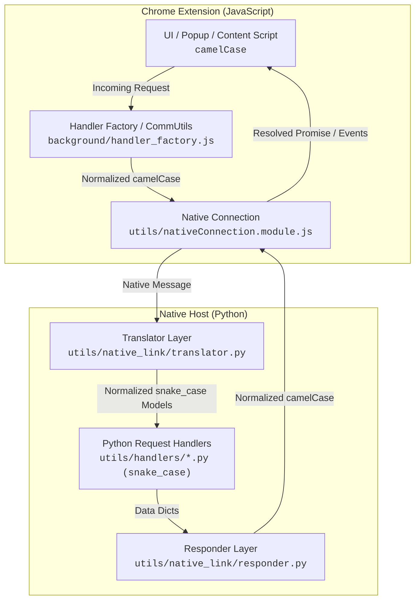

# Bridge & Native Messaging Protocol Architecture

This skill defines the communication protocol, serialization rules, automatic case-translation boundaries, and tab-broadcasting mechanisms between the Chrome Extension (JavaScript) and the Native Messaging Host (Python).

---

## 1. Native Messaging Protocol & Framing

Communication occurs over standard streams (`stdin` / `stdout`) using Chrome's 32-bit native messaging framing protocol:

```
[4 Bytes: Message Length (Little-Endian Uint32)] [N Bytes: UTF-8 Encoded JSON]
```

### Protocol Constraints & Security

- **Python Receiver (`native_host.py:get_message`):**
  - Reads the 4-byte length header: `struct.unpack('@I', raw_length)[0]`.
  - Enforces `MAX_IPC_MESSAGE_SIZE` (5 MB limit) before reading payload to prevent DoS via memory exhaustion.
  - EOF on `stdin` indicates browser exit; Native Host terminates gracefully.
- **Python Sender (`native_host.py:send_message`):**
  - Masks paths recursively (`mask_path`) before transmission to prevent local path disclosure.
  - Translates `snake_case` keys to `camelCase` via `responder._translate_keys`.
  - Writes 4-byte length prefix: `struct.pack('@I', len(encoded_content))` followed by payload.
  - Enforces synchronized write access with `print_lock = threading.Lock()` and flushes immediately: `sys.stdout.buffer.flush()`.

---

## 2. Message Envelope & Request Correlation

### Request Envelope (JS → Python)

```javascript
{
  action: "play",           // ALWAYS snake_case
  request_id: "req_123",    // Preserved verbatim (matches Promise)
  folder_id?: "Default",    // Optional folder identifier
  ...data                   // Remaining payload fields in camelCase
}
```

### Response Envelope (Python → JS)

```javascript
{
  success: true,            // Operation status boolean
  request_id: "req_123",    // Preserved verbatim
  result?: { ... },         // Optional payload result
  error?: "Error message",  // Error string if success is false
  log?: {                   // Optional log object
    text: "...",
    type: "info" | "error"
  }
}
```

### Unsolicited Native Events (Python → JS)

The Native Host pushes asynchronous status events directly over stdout without an initiating browser request (e.g., player lifecycle events):
- Common actions: `mpv_exited`, `update_last_played`, `update_item_resume_time`, `update_item_marked_as_watched`, `playback_status_changed`, `playback_health_changed`, `item_natural_completion`, `session_restored`, `task_update`, `log`.
- Dispatched via `addNativeListener(action, callback)` in `utils/nativeConnection.module.js`.
- Payload keys are automatically converted to `camelCase` before dispatching to frontend callbacks.

---

## 3. Automated Case Translation Architecture

The system maintains a bidirectional, recursive translation layer. **Never manually patch casing in individual logic handlers.**



### Rules & Whitelists

1. **Python Backend:** Write idiomatic `snake_case` for all variables, dictionary keys, and methods.
2. **JavaScript Frontend:** Write idiomatic `camelCase` for all object properties, variables, and functions.
3. **Action Key:** The `action` name **ALWAYS** remains `snake_case` (e.g., `"play"`, `"get_ui_preferences"`, `"remove_item_live"`, `"log_event"`, `"export_data"`).
4. **Preserved Keys Whitelist:**
   - `request_id`, `url`, `m3u8` are strictly excluded from case conversion in both directions.

### Translation Points in Code

- **Incoming to Background:** `background/handler_factory.js` invokes `normalizeKeys(rawRequest)` from `utils/commUtils.module.js`.
- **Incoming to Native Host:** `utils/native_link/translator.py:translate(message)` recursively converts all incoming keys to `snake_case` before constructing strongly typed dataclasses.
- **Outgoing to Browser:** `utils/native_link/responder.py:_translate_keys(data)` and `success()` / `failure()` recursively convert `snake_case` keys back to `camelCase`.

---

## 4. Request Dataclass Models & Contract Sync

All native actions are mapped to typed Python dataclasses in `utils/native_link/models.py`:

- `PlaybackRequest`: `play`, `play_batch`, `play_m3u`, `append`, `play_new_instance`.
- `LiveUpdateRequest`: `remove_item_live`, `remove_items_live`, `reorder_live`, `clear_live`, `update_item_marked_as_watched`, `is_mpv_running`, `get_playback_status`, `close_mpv`.
- `DataSyncRequest`: `export_data`, `export_playlists`, `export_all_playlists_separately`, `import_from_file`, `set_ui_preferences`, `get_unified_diagnostics`, `get_smart_reorder`, `get_metadata_cache`, `cancel_task`.
- `ServiceRequest`: `get_anilist_releases`, `check_dependencies`.
- `LogRequest` & `LogBrowserErrorRequest`: `log_event`, `log_browser_error`.

### Bridge Contract Synchronization

To prevent contract drift between Python dataclasses and JavaScript tests:
- `testing_tools/generate_bridge_contract.py` reads `models.py` and `ACTION_MAP` to generate `testing_tools/scripts/bridge_contract.js`.
- When adding or changing fields in `models.py`, the contract script must be re-run (executed automatically during `python3 verify_changes.py`).

---

## 5. Background Handler Factory Pipeline

`background/handler_factory.js:createHandler(logic, options)` wraps background actions with standard side-effects:

```javascript
export const handleAddUrl = createHandler(async ({ request, data, folderId }) => {
    // Core action logic...
    return { success: true, folderId };
}, {
    requireFolder: true,         // Validates folderId presence
    syncToNative: true,          // Triggers debounced disk backup
    syncImmediate: false,        // If true, bypasses debouncing
    broadcastFolders: false,     // Broadcasts folder changes to all tabs
    broadcastPlaylist: true,     // Broadcasts updated playlist items to all tabs
    broadcastPreferences: false, // Broadcasts preference updates
    updateMenus: true            // Updates context menus
});
```

---

## 6. Tab Broadcasting Architecture

The Background Service Worker coordinates UI updates across all active browser tabs:

- **`background/messaging.js:broadcastToTabs(message)`:** Iterates through active tabs querying `{}` and transmits via `chrome.tabs.sendMessage()`.
- **`background/ui_broadcaster.js:broadcastPlaylistState(folderId)`:** Fetches the specified playlist shard and pushes `action: "playlistUpdated"` to all content scripts.
- **`broadcastLog({ text, type })`:** Pushes communication log events to all open UI surfaces (Popup and on-page controller).

---

## 7. Bridge Troubleshooting Checklist

- **"Bridge call timeout / receiving end does not exist":**
  1. The Python Native Host failed to boot or crashed immediately upon launch.
  2. Check `data/native_host.log` or the emergency crash log (`~/.local/share/MPVPlaylistOrganizer/native_host_crash.log`) for tracebacks.
  3. Ensure execution permissions on `run_native_host.sh` or Python host binary.
- **"Access Denied / Specified native messaging host not found":**
  - Run `python3 installer.py` to register the native messaging host JSON manifest in Chrome's native messaging directory (`~/.config/google-chrome/NativeMessagingHosts/com.mpv_playlist_organizer.handler.json`).
- **Silent Parameter Drops:**
  - If a parameter passed from JS disappears before reaching Python handler logic, check whether the key was included in the dataclass inside `utils/native_link/models.py`. Keys not declared in the model are dropped during `translator.py` instantiation.
