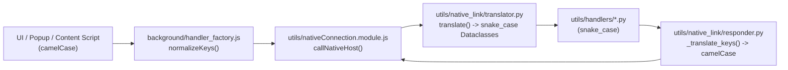

# Bridge & Native Messaging Protocol Architecture

This skill defines the communication protocol, automatic case-translation boundaries, background handler factory, and tab-broadcasting rules between the Chrome Extension and the Python Native Host.

> [!IMPORTANT]
> For binary framing details, request/response envelopes, preserved-key matrices, and the full `models.py` dataclass action catalog, see [references/PROTOCOL_SPEC.md](references/PROTOCOL_SPEC.md).

---

## 1. Core Protocol & Case-Translation Architecture

The system maintains a bidirectional, recursive key-translation layer across Chrome's 32-bit length-prefixed native messaging pipe (`stdin`/`stdout`). **Never manually patch key casing inside individual feature handlers.**

### Non-Negotiable Casing & Framing Invariants
1. **Action Names:** `action` values **ALWAYS** remain `snake_case` (e.g., `"play_batch"`, `"get_ui_preferences"`, `"remove_item_live"`).
2. **Language Idioms:** Write `camelCase` in JavaScript and `snake_case` in Python.
3. **Preserved Keys:** `request_id`, `url`, `m3u8` (plus map containers like `folders`, `domains`, `headers`, `customNames`, and `SUBTREE_PRESERVE_KEYS` for YouTube Tools backups) are excluded from key-casing conversion (see [references/PROTOCOL_SPEC.md](references/PROTOCOL_SPEC.md)).
4. **Contract Synchronization:** Adding a new action or request field requires updating `utils/native_link/models.py` and `utils/native_link/translator.py`. `testing_tools/generate_bridge_contract.py` auto-generates `testing_tools/scripts/bridge_contract.js` during verification.

---

## 2. Background Handler Factory & Tab Broadcasting

### `background/handler_factory.js:createHandler(logic, options)`
Wraps background message handlers with standardized validation, storage persistence, and UI broadcasting:
- `requireFolder`: Validates `folderId` presence before running `logic`.
- `syncToNative` / `syncImmediate`: Triggers debounced or immediate native disk backup.
- `broadcastFolders` / `broadcastPlaylist` / `broadcastPreferences`: Pushes state updates via `background/ui_broadcaster.js`.
- `updateMenus`: Rebuilds browser context menus (`utils/contextMenu.js`).
- `manualPersistence`: Skips automatic storage writes for read-only or export-only handlers.

### Tab Broadcasting (`background/messaging.js`, `background/ui_broadcaster.js`)
- `broadcastToTabs(message)`: Sends to internal extension views (`chrome.runtime.sendMessage`) and queries `{ active: true }` tabs (`chrome.tabs.sendMessage`) so background tabs are not unnecessarily woken up.
- `broadcastPlaylistState(folderId)`: Pushes `action: "playlistUpdated"` for the target shard.
- `broadcastLog(logObject)`: Resolves optional `itemId`/`folderId` titles and broadcasts UI log notifications.

---

## 3. Audit Guardrails

### MV3 Service Worker Lifecycle
The service worker terminates after ~30s of inactivity. **In-memory variables are caches, never authoritative state:**
1. Persist state that must survive worker suspension (Auto-Add toggles, pending clears, queued appends, scanner state) in `chrome.storage.session` or `chrome.storage.local`, and rehydrate on worker startup.
2. Use `chrome.alarms` (created in `onInstalled`/`onStartup` or guarded with `alarms.get`) for timers longer than a few seconds; reserve `setTimeout` for sub-second debouncing.

### Native Connection & Framing (`utils/nativeConnection.module.js`, `native_host.py`)
1. **Timeouts & Isolation:** Every `callNativeHost` call enforces `DEFAULT_REQUEST_TIMEOUT_MS` (30s) and cleans up its `requestPromises[requestId]` entry on timeout or disconnect. `dispatchNativeEvent` wraps each listener in `try/catch` so one failing callback cannot starve others.
2. **No Upward Imports:** `utils/*.module.js` must never import from `background/`; inject callbacks via setters (`setLogBroadcaster`, `logger.setNativeSender`).
3. **Outbound Size Guard:** `native_host.py:send_message_binary` soft-trims optional preview fields above `800 KB` (`SAFE_OUTBOUND_PAYLOAD_SIZE`) and hard-blocks payloads above `900 KB` (`MAX_OUTBOUND_MESSAGE_SIZE`), returning a structured failure with the same `request_id`.
4. **CLI Mode Separation:** Terminal CLI invocations must use `send_message_cli` (`set_active_sender`) so binary native-messaging frames never reach a terminal.
5. **Active-Tab Refresh:** Because `broadcastToTabs` only targets active tabs, always push a state refresh on `chrome.tabs.onActivated`.
