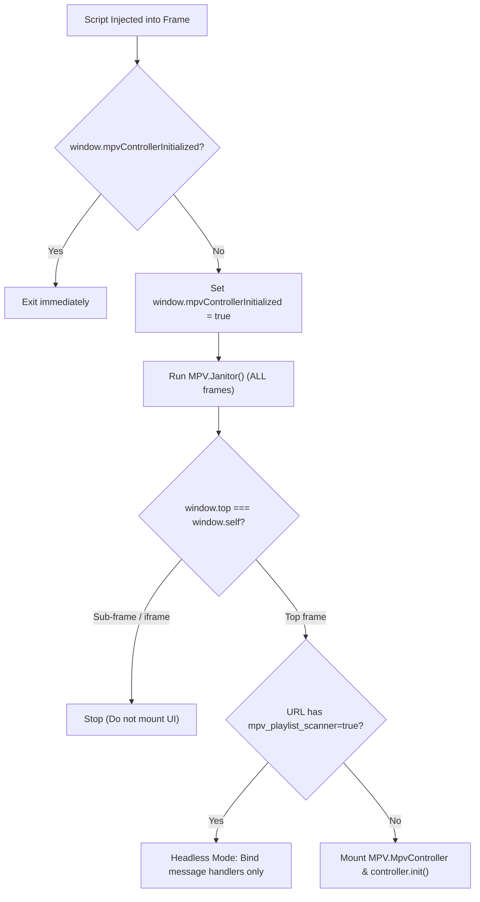

# Content Script Lifecycle, Multi-Frame Isolation & Resilience

This skill defines the content script injection pipeline, top-frame vs. sub-frame partitioning, Single-Page Application (SPA) navigation tracking, and non-destructive failure recovery.

> [!IMPORTANT]
> For the 4-stage `injectIntoTab` ping-first recovery diagram, isolated failure logging, and `isExtensionReloadError` code patterns, see [references/INJECTION_AND_RECOVERY.md](references/INJECTION_AND_RECOVERY.md).

---

## 1. Multi-Frame Isolation & Entry Point Routing (`content.js`)

`manifest.json` declares `"all_frames": true` in `content_scripts` so automated scrapers and click-assist janitors can reach embedded video players inside third-party iframes:

### Frame Execution Invariants
1. **Top-Frame Controller Exclusivity:** `MPV.MpvController` **MUST ONLY** mount in the top-level window (`window.top === window.self`). Never instantiate UI overlays or Shadow DOM roots inside sub-frames.
2. **Sub-Frame Janitor Automations (`utils/janitor.js`):** `MPV.Janitor` runs across all frames to handle site-specific button automation (e.g., auto-clicking "Click to Load" overlays inside streaming iframes on AnimePahe/Kwik).
3. **Headless Scanner Mode:** When a tab URL contains `mpv_playlist_scanner=true`, `content.js` skips `controller.init()` and binds message listeners only (`controller.handleMessage`).

---

## 2. Recovery Injection & Teardown (`background.js:injectIntoTab`)

- **Ping-First Check:** Always ping the tab (`{ action: "ping" }`) on Attempt 1 after confirming `tab.status === "complete"` and checking `restrictedDomains`. If responsive, sync state via `handleContentScriptInit` and return without re-injecting.
- **Pre-Injection Teardown & DOM Sweep:** Before calling `chrome.scripting.executeScript` (using `chrome.runtime.getManifest().content_scripts[0].js`), invoke existing controller `teardown()`/`destroy()`, purge `#m3u8-controller-host`, `#m3u8-minimized-host`, `#anilist-panel-host`, and `#mpv-organizer-host-styles`, and reset `window.mpvControllerInitialized = false`.
- **No Extension Reloads:** If 3 attempts fail, log a persisted error and broadcast a user notification via `broadcastLog`—**never** call `chrome.runtime.reload()`.

---

## 3. SPA Navigation Tracking (`utils/NavigationObserver.js`)

`NavigationObserver` detects dynamic History API page transitions (YouTube, Twitch) via a tri-tier strategy:
1. **Debounced URL Checker (250ms):** Detects path/query changes and triggers `onNavigation(newUrl, oldUrl)`.
2. **Debounced MutationObserver (500ms):** Observes `document.documentElement` (`childList`, `subtree`) for player DOM swaps.
3. **Periodic Fallback Poller (1000ms):** Guarantees detection when site frameworks suppress mutation events.
- **Teardown Rule:** `NavigationObserver.destroy()` **must** disconnect the `MutationObserver` and clear all timers/intervals when the controller is destroyed.

---

## 4. Audit Guardrails

1. **One primary injection mechanism:** `manifest.json` `content_scripts` is primary; `injectIntoTab` is strictly a recovery path after extension reload/update or tab activation.
2. **Never tear down loading tabs:** Wait for `tab.status === "complete"` before running ping checks or teardown sweeps.
3. **Log level discipline:** Routine injection and activation logs use `debug` (`persist: false`); only confirmed multi-attempt failures use `warn`/`error` with `persist: true`.
4. **Bounded self-healing:** Per-tab cooldowns and bounded retry counts (`MAX_ATTEMPTS = 3`). Never escalate a tab failure to `chrome.runtime.reload()`.
5. **Every timer/observer needs a `destroy()` path:** All `setInterval` and `MutationObserver` instances in `MpvController`, `ControllerTimers`, `NavigationObserver`, and `yt_bridge.js` must be cleaned up on teardown/context invalidation.
6. **Prototype-safe dispatch maps:** Action dispatch maps must use `Object.hasOwn` or a `Map` so `"__proto__"` or `"constructor"` keys cannot be invoked.
