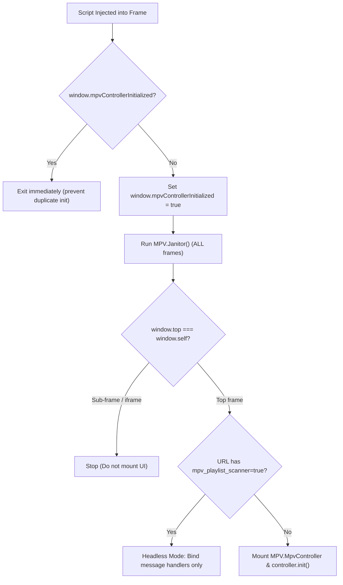

# Content Script Lifecycle, Multi-Frame Isolation & Resilience

This skill defines the content script injection pipeline, top-frame vs sub-frame partitioning, Single-Page Application (SPA) navigation tracking, and automated failure recovery mechanisms.

---

## 1. Multi-Frame Isolation & Entry Point Routing (`content.js`)

The extension manifest declares `"all_frames": true` in `content_scripts` to allow automated scrapers and click-assist janitors to reach embedded video players located in third-party iframes:



### Invariant Rules for Frame Execution

1. **Top-Frame Controller Exclusivity:** `MPV.MpvController` **MUST ONLY** mount in the top-level window (`window.top === window.self`). Never instantiate UI overlays, Shadow DOM roots, or user control buttons inside sub-frames or ad iframes.
2. **Sub-Frame Janitor Automations (`utils/janitor.js`):** `MPV.Janitor` runs across all frames to handle site-specific button automation (e.g. auto-clicking "Click to Load" overlays inside streaming iframes on AnimePahe/Kwik).
3. **Headless Scanner Mode:** When a tab is opened with `?mpv_playlist_scanner=true`, `content.js` skips `controller.init()` and binds message listeners only (`controller.handleMessage`) to prevent displaying UI while scraping in the background.

---

## 2. In-Page Injection Pipeline (`background.js:injectIntoTab`)

Dynamic injection into existing tabs during extension startup, reload, or tab switching follows a strict 4-stage guarded lifecycle:

```
┌─────────────────────────────────────────────────────────────────────────┐
│ 1. URL & Domain Validation                                              │
│ • Skip restricted schemes: chrome://, about:, chrome.google.com/webstore│
│ • Skip domains configured in settings.uiPreferences.global.restrictedDom│
├─────────────────────────────────────────────────────────────────────────┤
│ 2. Early Alive Check (Attempt 1 Only)                                   │
│ • Send ping: chrome.tabs.sendMessage(tab.id, { action: "ping" })        │
│ • If responsive: Sync UI state via handleContentScriptInit and RETURN.  │
├─────────────────────────────────────────────────────────────────────────┤
│ 3. Pre-Injection DOM Sweep                                              │
│ • executeScript purges lingering hosts from previous injections:        │
│   #m3u8-controller-host, #m3u8-minimized-host, #anilist-panel-host,     │
│   #mpv-organizer-host-styles                                            │
│ • Resets window.mpvControllerInitialized = false                        │
├─────────────────────────────────────────────────────────────────────────┤
│ 4. Script Execution & Verification                                      │
│ • executeScript with manifest.content_scripts[0].js                     │
│ • Sleep 200ms -> Verification ping                                      │
│ • If unresponsive -> Retry up to 3 times (2000ms delay)                 │
│ • If 3 attempts fail -> Trigger "Hail Mary" runtime reload              │
└─────────────────────────────────────────────────────────────────────────┘
```

> [!CAUTION]
> **Never inject without the Pre-Injection DOM Sweep:**
> Re-injecting scripts without purging previous host elements causes orphaned Shadow DOM containers, duplicated event listeners, and memory leaks.

---

## 3. "Hail Mary" Recovery Loop

If a content script fails injection across all 3 attempts (e.g. browser tab is in an unresponsive, wedged state):

1. **Set Pending State:**
   ```javascript
   await chrome.storage.local.set({ hail_mary_pending: true });
   chrome.runtime.reload();
   ```
2. **Post-Reload Detection:**
   On background worker boot, `background.js` checks `hail_mary_pending`:
   ```javascript
   chrome.storage.local.get("hail_mary_pending", (data) => {
       if (data.hail_mary_pending) {
           setTimeout(() => {
               broadcastLog({
                   text: "[System]: Extension was automatically restarted to recover from a blocked or unresponsive on-page controller.",
                   type: "info"
               });
               chrome.storage.local.remove("hail_mary_pending");
           }, 1000);
       }
   });
   ```

---

## 4. Single-Page Application (SPA) Tracking (`utils/NavigationObserver.js`)

Modern video sites (YouTube, Twitch) transition pages dynamically via History API mutations without triggering full browser reloads.

`NavigationObserver` deploys a tri-tier monitoring strategy:
1. **Debounced URL Checker (250ms):** Detects path/query string changes and dispatches `onNavigation(newUrl, oldUrl)`.
2. **Debounced Mutation Observer (500ms):** Observes `document.documentElement` (`childList`, `subtree`) to detect player DOM swaps.
3. **Periodic Fallback Poller (1000ms):** Interval poller guarantees detection even when mutation events are suppressed by custom site frameworks.

### Cleanup Invariant
When the controller is destroyed or re-initialized, `NavigationObserver.destroy()` **MUST** disconnect the `MutationObserver` and clear the poller interval to prevent detached DOM leaks.

---

## 5. Extension Context Invalidation Guard

When the extension reloads or updates, content scripts residing in open browser tabs lose their communication channel with the background worker. Subsequent calls to `chrome.runtime.sendMessage` throw:
`Error: Extension context invalidated.`

### Mandatory Defensive Pattern
All content script listeners and promise chains must wrap calls with `isExtensionReloadError`:

```javascript
import { isExtensionReloadError } from "./commUtils.module.js";

try {
    await chrome.runtime.sendMessage(payload);
} catch (err) {
    if (isExtensionReloadError(err)) {
        // Suppress noise: extension reloaded or updated
        return;
    }
    console.error("[MPV] Runtime message failed:", err);
}
```

---

## 6. Anti-Patterns & Common Traps

- ❌ **Injecting into sub-frames:** Allowing `MpvController` to initialize in iframes leads to recursive overlay rendering and crashed player embeds.
- ❌ **Skipping the ping check:** Always ping first on Attempt 1. Re-executing scripts over a live controller destroys active user text inputs and drag positions.
- ❌ **Hardcoding the script list in `background.js`:** Always derive content script paths directly from `chrome.runtime.getManifest().content_scripts[0].js`.
