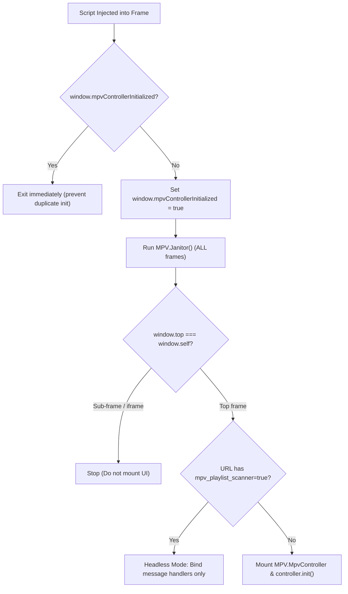

# Content Script Lifecycle, Multi-Frame Isolation & Resilience

This skill defines the content script injection pipeline, top-frame vs sub-frame partitioning, Single-Page Application (SPA) navigation tracking, and automated failure recovery mechanisms.

---

## 1. Multi-Frame Isolation & Entry Point Routing (`content.js`)

The extension manifest declares `"all_frames": true` in `content_scripts` to allow automated scrapers and click-assist janitors to reach embedded video players located in third-party iframes:



### Invariant Rules for Frame Execution

1. **Top-Frame Controller Exclusivity:** `MPV.MpvController` **MUST ONLY** mount in the top-level window (`window.top === window.self`). Never instantiate UI overlays, Shadow DOM roots, or user control buttons inside sub-frames or ad iframes.
2. **Sub-Frame Janitor Automations (`utils/janitor.js`):** `MPV.Janitor` runs across all frames to handle site-specific button automation (e.g. auto-clicking "Click to Load" overlays inside streaming iframes on AnimePahe/Kwik).
3. **Headless Scanner Mode:** When a tab is opened with `?mpv_playlist_scanner=true`, `content.js` skips `controller.init()` and binds message listeners only (`controller.handleMessage`) to prevent displaying UI while scraping in the background.

---

## 2. Ping-First Recovery Injection Pipeline (`background.js:injectIntoTab`)

Declarative `content_scripts` in `manifest.json` serve as the primary injection mechanism for normal page navigations. Dynamic recovery injection via `injectIntoTab` (used on extension startup, reload, or tab activation) follows a strict 4-stage ping-first guarded lifecycle:

```
┌─────────────────────────────────────────────────────────────────────────┐
│ 1. Tab Readiness, URL & Domain Validation                               │
│ • Require tab.status === "complete" (never tear down loading tabs)      │
│ • Skip restricted schemes: chrome://, about:, Chrome Web Store          │
│ • Skip domains configured in settings.uiPreferences.global.restrictedDom│
├─────────────────────────────────────────────────────────────────────────┤
│ 2. Early Alive Check (Attempt 1 Only — Ping-First Recovery)             │
│ • Send ping: chrome.tabs.sendMessage(tab.id, { action: "ping" })        │
│ • If responsive: Sync UI state via handleContentScriptInit and RETURN.  │
├─────────────────────────────────────────────────────────────────────────┤
│ 3. Pre-Injection Teardown & DOM Sweep                                   │
│ • Call existing controller teardown() / destroy() if present, and purge │
│   lingering hosts from previous injections:                             │
│   #m3u8-controller-host, #m3u8-minimized-host, #anilist-panel-host,     │
│   #mpv-organizer-host-styles                                            │
│ • Resets window.mpvControllerInitialized = false                        │
├─────────────────────────────────────────────────────────────────────────┤
│ 4. Script Execution & Verification (No chrome.runtime.reload())         │
│ • executeScript with manifest.content_scripts[0].js                     │
│ • Sleep 200ms -> Verification ping                                      │
│ • If unresponsive -> Retry up to 3 times (2000ms delay)                 │
│ • If 3 attempts fail -> Log error & broadcast user notice (No reload)   │
└─────────────────────────────────────────────────────────────────────────┘
```

> [!CAUTION]
> **Never inject without the Pre-Injection Teardown & DOM Sweep:**
> Re-injecting scripts without tearing down timers/observers and purging previous host elements causes orphaned Shadow DOM containers, duplicated event listeners, and memory leaks.

---

## 3. Failure Recovery Policy (Hail Mary Removed)

Previously, injection failures triggered an automatic `chrome.runtime.reload()` ("Hail Mary"). This pattern has been **completely removed** because reloading the extension terminates active native messaging connections, destroys in-memory worker state, and can cause reload loops during page loads or bfcache restores.

Under the current architecture:
1. **Logged Failure:**
   When verification fails after 3 attempts, `background.js` logs a persisted error:
   ```javascript
   logger.error(`[Background] ALL injection attempts failed for tab ${tab.id}. Content script could not be verified.`, { persist: true });
   ```
2. **User Notification:**
   A user-facing notification is broadcast via `broadcastLog` without restarting the extension:
   ```javascript
   broadcastLog({
       text: `[System]: Failed to connect to page controller on tab ${tab.id} after ${MAX_ATTEMPTS} attempts. Please refresh the tab.`,
       type: "error"
   });
   ```
3. **No Global Side Effects:**
   The failure is isolated to the affected tab; other tabs and background services continue running uninterrupted.

---

## 4. Single-Page Application (SPA) Tracking (`utils/NavigationObserver.js`)

Modern video sites (YouTube, Twitch) transition pages dynamically via History API mutations without triggering full browser reloads.

`NavigationObserver` deploys a tri-tier monitoring strategy:
1. **Debounced URL Checker (250ms):** Detects path/query string changes and dispatches `onNavigation(newUrl, oldUrl)`.
2. **Debounced Mutation Observer (500ms):** Observes `document.documentElement` (`childList`, `subtree`) to detect player DOM swaps.
3. **Periodic Fallback Poller (1000ms):** Interval poller guarantees detection even when mutation events are suppressed by custom site frameworks.

### Cleanup Invariant
When the controller is destroyed or re-initialized, `NavigationObserver.destroy()` **MUST** disconnect the `MutationObserver` and clear the poller interval to prevent detached DOM leaks.

---

## 5. Extension Context Invalidation Guard

When the extension reloads or updates, content scripts residing in open browser tabs lose their communication channel with the background worker. Subsequent calls to `chrome.runtime.sendMessage` throw:
`Error: Extension context invalidated.`

### Mandatory Defensive Pattern
All content script listeners and promise chains must wrap calls with `isExtensionReloadError`. In classic content scripts (non-module), access `window.MPV_INTERNAL.isExtensionReloadError` (transpiled from `commUtils.module.js`); ES module `import` applies only in `background/` or `*.module.js`:

```javascript
// In classic content scripts: const { isExtensionReloadError } = window.MPV_INTERNAL;
// In ES modules (background/ or *.module.js):
import { isExtensionReloadError } from "./commUtils.module.js";

try {
    await chrome.runtime.sendMessage(payload);
} catch (err) {
    if (isExtensionReloadError(err)) {
        // Suppress noise: extension reloaded or updated
        return;
    }
    console.error("[MPV] Runtime message failed:", err);
}
```

---

## 6. Anti-Patterns & Common Traps

- ❌ **Injecting into sub-frames:** Allowing `MpvController` to initialize in iframes leads to recursive overlay rendering and crashed player embeds.
- ❌ **Skipping the ping check:** Always ping first on Attempt 1. Re-executing scripts over a live controller destroys active user text inputs and drag positions.
- ❌ **Hardcoding the script list in `background.js`:** Always derive content script paths directly from `chrome.runtime.getManifest().content_scripts[0].js`.


---

## 7. Audit Guardrails

> [!IMPORTANT]
> The historical "Hail Mary" `chrome.runtime.reload()` recovery pattern has been completely removed. It was a known hazard that killed the native port and all in-memory state. Self-healing must never escalate to a global side effect (such as an extension reload). Never call `chrome.runtime.reload()`.

1. **One injection mechanism.** `manifest.json` `content_scripts` is primary. `injectIntoTab` is only a recovery path after an extension reload/update. Do not add a second always-on injection path.
2. **Never tear down live UI on a failed ping** while the tab is still `loading`. Wait for `complete`, or skip.
3. **Injection logging is `debug`**, with only failures at `warn`/`error` and persisted. Never `persist: true` on routine activation logs.
4. **Cooldowns on any self-healing loop:** per-tab, bounded attempts, and a global minimum interval. Self-heal must never escalate to a global side effect (extension reload).
5. **Content-script initialization flags** (`window.mpvControllerInitialized`) must be reset only by an explicit `destroy()`, never by the injection cleanup itself.
6. **Intervals/observers must have a `destroy()` path** (`MpvController` heartbeat and watchdog included). New `setInterval` requires a matching clear in the teardown test.
7. **Dispatch maps** (`actionHandlers`) use `Object.hasOwn` or a `Map`. Plain `obj[action]` lets `"constructor"`/`"__proto__"` through.
8. **Dynamic `innerHTML`:** any interpolated value that originates from a page title, URL, or external API (AniList) must go through `textContent` or an escape helper. Static templates only.
