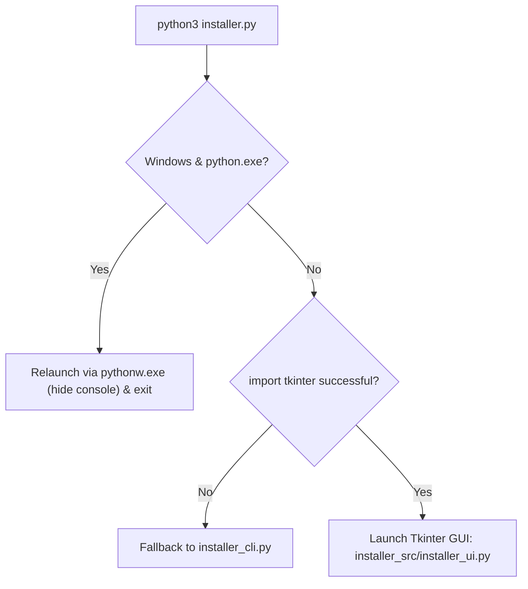

# Native Host Installer, CLI & Dependency Architecture

This skill defines cross-platform Native Messaging Host registration, extension ID validation, dual GUI/CLI installer workflows, standalone terminal CLI playback, and dependency management.

> [!IMPORTANT]
> For per-OS browser manifest paths, Windows registry keys, manifest JSON schema, and generated wrapper script templates (`run_native_host.*`, `mpv-cli*`), see [references/INSTALLER_PATHS_AND_WRAPPERS.md](references/INSTALLER_PATHS_AND_WRAPPERS.md).

---

## 1. Native Host Registration & Extension ID Validation (`installer_src/installer_logic.py`)

- **Extension ID Validation (`validate_extension_id`):** Enforces `EXTENSION_ID_PATTERN = re.compile(r"^[a-p]{32}$")` before writing `"allowed_origins": [f"chrome-extension://{extension_id}/"]` into `DATA_DIR/com.mpv_playlist_organizer.handler-chrome.json`.
- **Auto-Detection (`InstallerLogic.find_extension_id`):** Scans Chromium browser profile `Preferences` files (`Default`, `Guest Profile`, `Profile 1..30`) and matches `extensions.settings.<ext_id>.path` against `INSTALL_DIR` via `os.path.samefile` / `os.path.realpath`.
- **Multi-Browser Registration:** Links or registers the manifest across all detected Chromium-family browsers (Chrome, Chromium, Brave, Edge, Vivaldi, Opera) under user-scoped directories/registry (`HKEY_CURRENT_USER` on Windows; `~/.config/` or `~/Library/Application Support/` symlinks on Linux/macOS).

---

## 2. Dual GUI / CLI Installer Lifecycle (`installer.py` & `installer_cli.py`)

- **Windows Console Detachment (`installer.py` / `WindowsLogic._get_console_python`):** `installer.py` detaches from the console window on Windows, while `WindowsLogic._get_console_python()` ensures `run_native_host.bat` and `mpv-cli.bat` always target `python.exe` (never `pythonw.exe`, which lacks `stdin`/`stdout` handles required for stdio native messaging).
- **Headless Terminal Installer (`installer_cli.py`):** Provides full install, uninstall, ID detection, CLI wrapper creation, PATH setup, and diagnostics without requiring `tkinter`.

---

## 3. Standalone Terminal CLI Mode (`cli.py`, `native_host.py`)

`native_host.py` can be invoked directly from a terminal via `mpv-cli` (`mpv-cli list`, `mpv-cli play "<folder_id>"`):
- **Binary Framing Bypass (`native_host.py:send_message_cli`):** When not launched by a browser (`is_browser == False`), `native_host.py` calls `set_active_sender(send_message_cli)` and delegates to `cli.handle_cli()`, preventing binary 32-bit length-prefixed native messaging frames from being written to terminal `stdout`.

---

## 4. Dependency Management (`utils/dependency_manager.py`, `native_host.py`)

- **5-Minute Status Cache (`check_mpv_and_ytdlp_status`):** Caches availability, resolved paths, and version strings for `mpv`, `yt-dlp`, `ffmpeg`, and `node` for `CACHE_EXPIRY_SECONDS = 300`.
- **`yt-dlp` Auto-Updater (`update_ytdlp`):** Runs `<ytdlp_path> -U` with `security.get_scrubbed_env()`. On Linux, if `os.access(ytdlp_path, os.W_OK)` is false, `_get_linux_sudo_command_prefix` checks for graphical privilege elevation tools (`pkexec`, `gksu`, `kdesu`) or instructs the user to run `sudo yt-dlp -U`.
- **Environment `PATH` Augmentation (`native_host.py:_configure_environment_paths`):** Appends standard system/user binary directories (`~/.local/bin`, `~/bin`, `/usr/local/bin`) and configured `ffmpeg_path`/`node_path` directories to `os.environ["PATH"]` at startup.

---

## 5. Audit Guardrails

1. **Validate the extension ID** via `validate_extension_id` (`^[a-p]{32}$`) before writing manifests.
2. **Quote paths in generated wrappers** (`shlex.quote` in `UnixLogic.install` / `install_cli`; double-quoted paths in `WindowsLogic`). Never embed raw unquoted `sys.executable` or script paths.
3. **Import-safe installer modules:** Importing `installer_src/installer_logic.py` or `installer_cli.py` must not trigger side effects at import time.
4. **CLI sender isolation:** Terminal CLI execution must always use `send_message_cli` so no binary frames reach terminal `stdout`.
5. **Read-only `DATA_DIR` resilience:** `utils/logger.py:initialize` and `file_io.py:get_user_data_dir` must fall back to `tempfile.gettempdir()` or `stderr` logging if the user data directory is unwritable.
