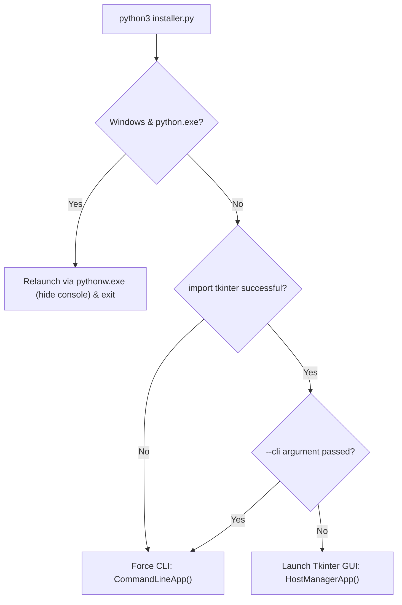

# Native Host Installer, CLI & Dependency Architecture

This skill defines cross-platform Native Messaging Host registration, extension ID synchronization, dual GUI/CLI installer workflows, standalone terminal playback commands, and automated dependency management.

---

## 1. Cross-Platform Manifest Registration (`installer_src/installer_logic.py`)

Chrome Native Messaging requires a JSON host manifest (`com.mpv_playlist_organizer.handler.json`) placed in platform-specific configuration directories (on Linux and macOS, the installer writes the canonical manifest to `data/com.mpv_playlist_organizer.handler-chrome.json` and symlinks it into each detected browser's `NativeMessagingHosts` directory):

```
Linux (Symlinks to data/com.mpv_playlist_organizer.handler-chrome.json):
~/.config/<browser>/NativeMessagingHosts/com.mpv_playlist_organizer.handler.json
(Browsers: google-chrome, chromium, BraveSoftware/Brave-Browser, microsoft-edge, vivaldi, opera)

macOS (Symlinks to data/com.mpv_playlist_organizer.handler-chrome.json):
~/Library/Application Support/<browser>/NativeMessagingHosts/com.mpv_playlist_organizer.handler.json
(Browsers: Google/Chrome, Chromium, BraveSoftware/Brave-Browser, Microsoft Edge, Vivaldi, com.operasoftware.Opera)

Windows:
Registry: HKCU\SOFTWARE\<Browser>\NativeMessagingHosts\com.mpv_playlist_organizer.handler
Default Value: C:\path\to\data\com.mpv_playlist_organizer.handler-chrome.json
```

### Runner Wrapper Scripts (`run_native_host.sh` & `run_native_host.bat`)
To ensure `PYTHONDONTWRITEBYTECODE=1` and the exact Python interpreter are used when the browser spawns the Native Host, the installer generates a platform wrapper script and registers it in the manifest `path` field:

```sh
# Linux / macOS: run_native_host.sh
#!/bin/sh
export PYTHONDONTWRITEBYTECODE=1

exec '/usr/bin/python3' "$(dirname "$0")/native_host.py" "$@"
```

```bat
:: Windows: run_native_host.bat
@echo off
set PYTHONDONTWRITEBYTECODE=1
"<python_executable>" "%~dp0native_host.py" %*
```

### Extension ID Synchronization Invariant
The extension ID is validated against `^[a-p]{32}$` (`validate_extension_id`) before writing manifests. The manifest `allowed_origins` array must match the installed Chrome extension ID:
```json
{
    "name": "com.mpv_playlist_organizer.handler",
    "description": "MPV Playlist Organizer Native Host",
    "path": "/path/to/run_native_host.sh",
    "type": "stdio",
    "allowed_origins": [
        "chrome-extension://<EXTENSION_ID>/"
    ]
}
```
When reinstalling or updating IDs, the installer updates the manifest and links/registers across all detected browsers simultaneously.

---

## 2. Dual GUI / CLI Installer Lifecycle (`installer.py`)

The installer seamlessly adapts to headless and desktop environments:



### Guardrails
1. **Silent Windows Detachment:** When double-clicked or executed via `python.exe` on Windows, `installer.py` immediately re-spawns itself via `pythonw.exe` to suppress unwanted persistent terminal windows.
2. **Headless Linux Resilience:** If `tkinter` is not installed (standard on minimal Linux servers or containers), the installer degrades gracefully to `CommandLineApp` without throwing an unhandled `ImportError`.

---

## 3. Standalone Terminal CLI Mode (`cli.py` & `mpv-cli`)

The Native Host script can be executed directly from a terminal to manage and play playlists without opening the browser:

### CLI Wrapper Script (`mpv-cli` & `mpv-cli.bat`)
```bash
# Linux / macOS wrapper (generated by UnixLogic.install_cli using shlex.quote)
#!/bin/sh
export PYTHONDONTWRITEBYTECODE=1

exec '/usr/bin/python3' '/path/to/native_host.py' "$@"

# Or repo portable wrapper:
#!/bin/sh
export PYTHONDONTWRITEBYTECODE=1
exec python3 "$(dirname "$(readlink -f "$0")")/native_host.py" "$@"

# Windows wrapper: mpv-cli.bat (generated by WindowsLogic.install_cli)
@echo off
set PYTHONDONTWRITEBYTECODE=1
"<python_executable>" "<script_path>" %*
```

### Terminal Commands
- **List Folders:**
  ```bash
  ./mpv-cli list
  # or: python3 native_host.py list
  ```
  Parses `data/index.json` and outputs all folder IDs and item counts.
- **Play Folder:**
  ```bash
  ./mpv-cli play <folder_id>
  ```
  Resolves folder items, prepares the MPV launch command, starts playback, blocks until player exit, and gracefully handles `KeyboardInterrupt`.

### Framing Bypass
When invoked from the command line, `native_host.py` switches the active bridge sender to `send_message_cli` (via `set_active_sender`) and `cli.handle_cli()` returns `True`, preventing `native_host.py` from entering the binary 32-bit length-prefixed Native Messaging loop or emitting binary frames to terminal stdout.

---

## 4. Automated Dependency Management (`utils/dependency_manager.py`)

The system verifies and maintains external executables: `mpv`, `yt-dlp`, `ffmpeg`, and `node`.

### Status Caching
`check_mpv_and_ytdlp_status` caches executable availability, paths, and version strings for **5 minutes** (`CACHE_EXPIRY_SECONDS = 300`) to avoid spawning redundant shell processes on frequent UI requests.

### yt-dlp Auto-Updater (`update_ytdlp`)
- Windows/macOS: Executes `yt-dlp -U`.
- Linux: Checks if the binary resides in a system path requiring elevation (`/usr/bin`, `/usr/local/bin`). If so, prompts via `pkexec` or `sudo -A` before running the update command.

### PATH Injection Guard
Browsers and desktop environments often launch native hosts with a stripped `PATH` (missing `~/.local/bin`, `/usr/local/bin`, or Homebrew paths). The runtime explicitly appends standard user bin paths to `os.environ["PATH"]` during initialization.

---

## 5. Anti-Patterns & Common Traps

- ❌ **Registering Chrome-only manifests on Linux:** Fails for users on Brave, Vivaldi, Chromium, or Edge. Always register across all detected browser config directories.
- ❌ **Hardcoding python interpreter path on Windows:** Always probe `sys.executable` and distinguish between `python.exe` (CLI) and `pythonw.exe` (GUI / background).
- ❌ **Leaving `allowed_origins` empty or wild-carded:** Chrome rejects Native Messaging manifests that lack an exact extension ID in `allowed_origins`.


---

## 6. Audit Guardrails

> [!NOTE]
> **Resolved Audit Findings (PY-H1, PY-L4, PY-L5):** CLI mode now injects a text logger / no-op sender (`send_message_cli`), completely bypassing binary length-prefixed framing on terminal stdout. Extension ID is validated against `^[a-p]{32}$` in `installer_logic.py` and `installer_cli.py`. Wrapper scripts quote executable and script paths via `shlex.quote`. All Firefox manifest references have been removed.

1. **Validate the extension ID** against `^[a-p]{32}$` before writing manifests.
2. **Quote paths in generated wrappers** (`shlex.quote` for `.sh`, proper quoting for `.bat`). Never embed raw `sys.executable` or script paths.
3. **Importing installer modules must have no side effects** (no data-dir creation at import time).
4. **Do not let the installer dirty tracked files.** `run_native_host.sh` is regenerated, so either gitignore the generated copy or generate it elsewhere.
5. **Document supported browsers.** Chromium-family only. Firefox needs `allowed_extensions` and a different manifest.
6. **Degrade gracefully on read-only data dirs.** `logger.initialize` must fall back to temp or stderr-only logging instead of crashing (see `native_host_crash.log`).
7. **Pin the mpv path after install.** Don't search the project dir or Python dir before PATH, and don't prepend them to PATH.
8. **Centralize** `PYTHONDONTWRITEBYTECODE` and the host version string in one place.
9. Windows uninstall removes the fallback registry key independently of Chrome's key.
