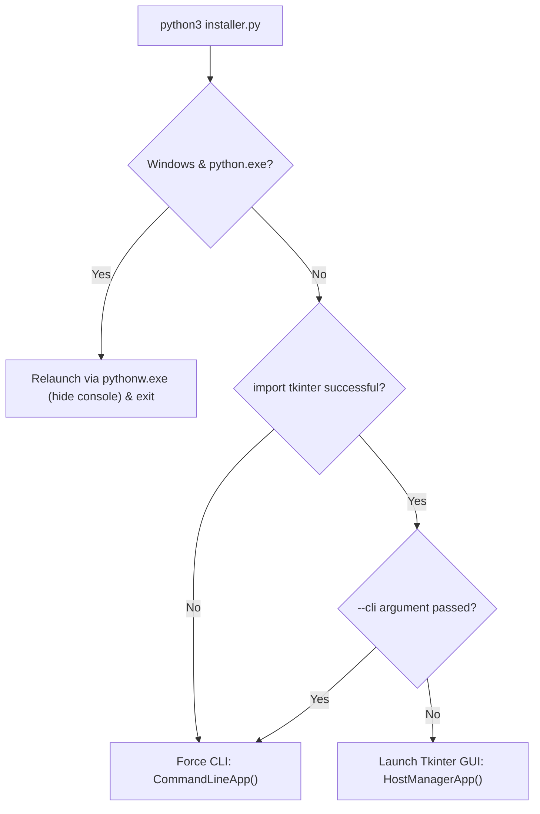

# Native Host Installer, CLI & Dependency Architecture

This skill defines cross-platform Native Messaging Host registration, extension ID synchronization, dual GUI/CLI installer workflows, standalone terminal playback commands, and automated dependency management.

---

## 1. Cross-Platform Manifest Registration (`installer_src/installer_logic.py`)

Chrome Native Messaging requires a JSON host manifest (`com.mpv_playlist_organizer.handler.json`) placed in platform-specific configuration directories:

```
Linux:
~/.config/<browser>/NativeMessagingHosts/com.mpv_playlist_organizer.handler.json
(Browsers: google-chrome, chromium, BraveSoftware/Brave-Browser, vivaldi, microsoft-edge)

macOS:
~/Library/Application Support/Google/Chrome/NativeMessagingHosts/com.mpv_playlist_organizer.handler.json

Windows:
Registry: HKCU\Software\Google\Chrome\NativeMessagingHosts\com.mpv_playlist_organizer.handler
Default Value: C:\path\to\data\com.mpv_playlist_organizer.handler-chrome.json
```

### Windows Runner Batch Wrapper
On Windows, Google Chrome cannot directly launch a `.py` script via Native Messaging. The installer generates `run_native_host.bat` pointing to `python.exe` and registers this batch file in the manifest `path` field:
```bat
@echo off
set PYTHONDONTWRITEBYTECODE=1
"<python_path>" "<script_path>" %*
```

### Extension ID Synchronization Invariant
The manifest `allowed_origins` array must match the installed Chrome extension ID:
```json
{
  "name": "com.mpv_playlist_organizer.handler",
  "description": "MPV Playlist Organizer Native Host",
  "path": "/path/to/native_host.py",
  "type": "stdio",
  "allowed_origins": [
    "chrome-extension://<EXTENSION_ID>/"
  ]
}
```
When reinstalling or updating IDs, the installer updates all registered browser manifests simultaneously.

---

## 2. Dual GUI / CLI Installer Lifecycle (`installer.py`)

The installer seamlessly adapts to headless and desktop environments:



### Guardrails
1. **Silent Windows Detachment:** When double-clicked or executed via `python.exe` on Windows, `installer.py` immediately re-spawns itself via `pythonw.exe` to suppress unwanted persistent terminal windows.
2. **Headless Linux Resilience:** If `tkinter` is not installed (standard on minimal Linux servers or containers), the installer degrades gracefully to `CommandLineApp` without throwing an unhandled `ImportError`.

---

## 3. Standalone Terminal CLI Mode (`cli.py` & `mpv-cli`)

The Native Host script can be executed directly from a terminal to manage and play playlists without opening the browser:

### CLI Wrapper Script (`mpv-cli`)
```bash
# Linux / macOS wrapper
exec python3 "$(dirname "$(readlink -f "$0")")/native_host.py" "$@"

# Windows wrapper: mpv-cli.bat
@echo off
set PYTHONDONTWRITEBYTECODE=1
"<python_executable>" "<script_path>" %*
```

### Terminal Commands
- **List Folders:**
  ```bash
  ./mpv-cli list
  # or: python3 native_host.py list
  ```
  Parses `data/index.json` and outputs all folder IDs and item counts.
- **Play Folder:**
  ```bash
  ./mpv-cli play <folder_id>
  ```
  Resolves folder items, prepares the MPV launch command, starts playback, blocks until player exit, and gracefully handles `KeyboardInterrupt`.

### Framing Bypass
When invoked from the command line, `cli.handle_cli()` returns `True`, preventing `native_host.py` from entering the binary 32-bit length-prefixed Native Messaging loop.

---

## 4. Automated Dependency Management (`utils/dependency_manager.py`)

The system verifies and maintains external executables: `mpv`, `yt-dlp`, `ffmpeg`, and `node`.

### Status Caching
`check_mpv_and_ytdlp_status` caches executable availability, paths, and version strings for **5 minutes** (`CACHE_EXPIRY_SECONDS = 300`) to avoid spawning redundant shell processes on frequent UI requests.

### yt-dlp Auto-Updater (`update_ytdlp`)
- Windows/macOS: Executes `yt-dlp -U`.
- Linux: Checks if the binary resides in a system path requiring elevation (`/usr/bin`, `/usr/local/bin`). If so, prompts via `pkexec` or `sudo -A` before running the update command.

### PATH Injection Guard
Browsers and desktop environments often launch native hosts with a stripped `PATH` (missing `~/.local/bin`, `/usr/local/bin`, or Homebrew paths). The runtime explicitly appends standard user bin paths to `os.environ["PATH"]` during initialization.

---

## 5. Anti-Patterns & Common Traps

- ❌ **Registering Chrome-only manifests on Linux:** Fails for users on Brave, Vivaldi, Chromium, or Edge. Always register across all detected browser config directories.
- ❌ **Hardcoding python interpreter path on Windows:** Always probe `sys.executable` and distinguish between `python.exe` (CLI) and `pythonw.exe` (GUI / background).
- ❌ **Leaving `allowed_origins` empty or wild-carded:** Chrome rejects Native Messaging manifests that lack an exact extension ID in `allowed_origins`.
