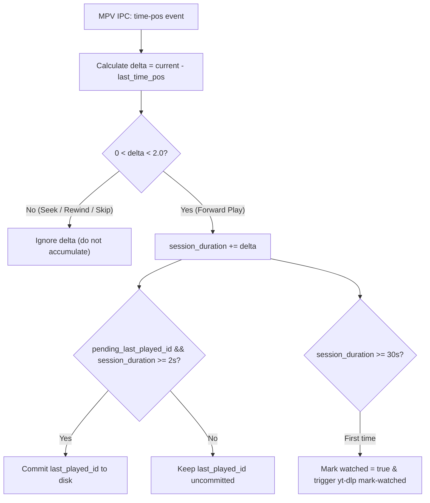
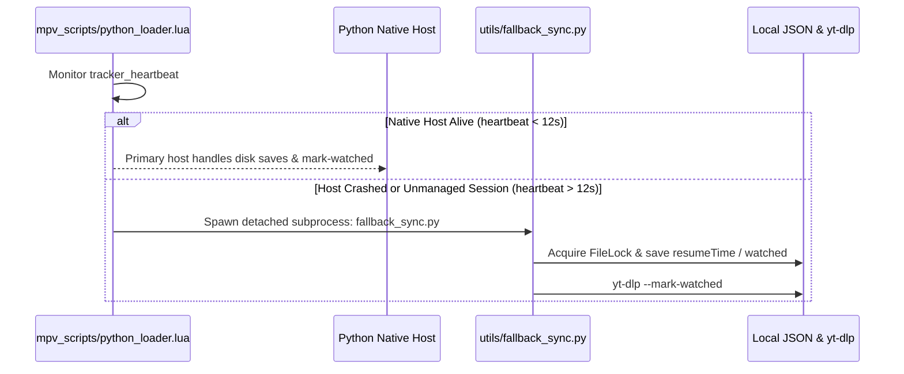

# Playback Tracking, Health Monitoring & Fallback Synchronization

This skill defines the runtime progress tracking mathematics, session health state machine, detached fallback synchronization, and asynchronous queue enrichment.

---

## 1. Monotonic Progress Math & Staged Commits (`playlist_tracker.py`)

Accurate watch tracking requires strict mathematical guardrails to avoid inflating viewing time on seeks or corrupting playlist state on player crashes:



### Critical Tracking Invariants
1. **Monotonic Forward Math:** `current_session_duration` must **only** accumulate forward playback deltas (`0 < delta < 2.0`). Seeks, rewinds, and track loops must never increment session watch duration.
2. **2-Second Staged State Commits:** Newly launched items mark `pending_last_played_id`. The item ID is committed to persistent storage **only after 2 seconds of confirmed forward playback** (`current_session_duration >= 2`). If playback crashes, closes, or fails stream extraction before 2 seconds, the commit is discarded, protecting `lastPlayedId` from corruption.
3. **Dual-Tier Disk Throttling:** In-memory resume positions update every 5 seconds of video time (`int(current_time) % 5 == 0`), but physical disk commits are throttled to 10-second intervals (`commit_interval`) to eliminate file lock contention.
4. **Late EOF Attribution Safety:** If an `end-file` event with reason `eof` arrives when `current_session_duration < 1.0`, it must be attributed to `previous_id` rather than `current_id` to prevent misattributing natural completion during rapid track changes.

---

## 2. Session Health State Machine (`utils/session_health.py`)

The native host maintains an active health monitor thread (`start_health_watcher(session)`) polling MPV every 500ms, guarded by `session_generation` token checks (`current_gen != gen`) so stale health watchers cannot mutate a newer session:

```
[OK] ──(1-2 IPC timeouts)──> [STALE] ──(3rd timeout)──> [DEAD]
 │                                                        │
 └───<──────(Successful IPC query)────────<───────────────┘
                                                          │
                                         (PID dead check: ipc_utils.is_pid_running)
                                                          │
                                                          ▼
                                             [Clear Session & Notify Browser]
```

- **IPC Ping:** Queries the `pid` property over IPC with a tight `0.3s` timeout.
- **State Notifications:** State transitions dispatch `action: "playback_health_changed"` to the Chrome extension.
- **Teardown on Dead:** When health reaches `"dead"` and `ipc_utils.is_pid_running(self.pid)` returns `False`, the session immediately purges IPC sockets, cleans temporary files, and resets session state.

---

## 3. Detached Fallback Synchronization (`python_loader.lua` & `fallback_sync.py`)

To ensure viewing progress and watch history are never lost—even if the Python Native Host crashes, the browser closes, or an unmanaged (⚡) instance is running—the system uses a Lua-backed detached fallback mechanism:



### Invariants for Fallback Execution
- **Heartbeat Gap Threshold:** `python_loader.lua` triggers fallback sync only if `tracker_heartbeat` has been missing for **more than 12 seconds**.
- **Detached Execution:** Fallback sync runs as an independent, detached subprocess with its own cross-process `FileLock` to guarantee safe concurrent access to playlist shards.

---

## 4. Asynchronous Queue Enrichment (`utils/session_services.py`)

Launching large playlists (100+ items) with synchronous stream extraction creates unbearable startup latency:

1. **Zero-Latency Play Promotion:**
   - Single item launch plays the target stream immediately (`LauncherService`).
   - `EnrichmentService` runs in the background, promoting the launch to a full folder session.
2. **Batched Streaming to MPV:**
   - Future and history items are enriched and appended to MPV's live playlist queue in **batches of 5 items** (`batch_size = 5`).
3. **Restored Process Watcher (`LauncherService.start_restored_process_watcher`):**
   - Detects natural completion flag files (`mpv_natural_completion_<pid>.flag`) in `session.FLAG_DIR` (`DATA_DIR/flags`) via `_safe_read_flag_file` (`os.O_RDONLY | os.O_NOFOLLOW`, 256-byte cap).
   - Preserves exit code `99` unless a manual user quit was detected.

---

## 5. Anti-Patterns & Common Traps

- ❌ **Committing `lastPlayedId` immediately upon stream launch:** If MPV fails to decode the stream or yt-dlp throws an error, the playlist state is corrupted with an unplayable item marked active.
- ❌ **Accumulating seeks into watch duration:** Calculating `duration += abs(delta)` allows users to instantly mark an hour-long video as watched by scrubbing back and forth.
- ❌ **Synchronous disk writes in the IPC event loop:** Blocking the IPC reader thread on file locks causes socket buffer overflow and dropped MPV events.
