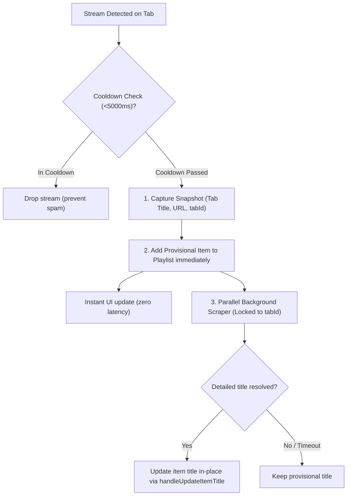

# Playlist Operations, Reordering & Ingestion Architecture

This skill defines the data mutation lifecycle for playlist items, schema normalization, automated stream ingestion, title-similarity clustering algorithms, and interactive drag-and-drop state machines.

---

## 1. Standardized Playlist Item Schema (`utils/item_processor.js`)

All playlist items across JavaScript and Python must conform to a standardized schema. Raw URLs or unvalidated objects must always pass through `processPlaylistItem`:

```javascript
{
    url: normalizedUrl,               // String: Cleaned and normalized URL (e.g. tracking params stripped)
    title: sanitizedTitle,           // String: Sanitized display title
    id: id || generateItemId(),      // String: UUIDv4 unique identifier
    settings: {},                    // Object: Item-specific playback overrides
    lastModified: Date.now(),        // Number: Milliseconds timestamp for LWW conflict resolution
    currentlyPlaying: false,         // Boolean: True if active in the MPV player
    watched: false,                  // Boolean: True if watched locally (>30s or natural EOF)
    resumeTime: 0,                   // Number: Playback resume position in seconds
    markedAsWatched: false           // Boolean: True if synchronized to external watch history (yt-dlp)
}
```

### Invariants for Item Processing
1. **URL & Title Sanitization:** Always sanitize input strings using `sanitizeString()` and `normalizeYouTubeUrl()` to prevent control character injection in `.m3u` files.
2. **Deterministic ID Preservation:** Never overwrite an existing `item.id` during title updates or reordering unless `forceNewId: true` is explicitly specified.
3. **Backend Enrichment & Playlist Expansion (`utils/item_processor.py`, `mpv_session.py`):** `ItemProcessor.enrich_single_item` verifies `original_url`, queries the global metadata cache, and expands dedicated YouTube playlist URLs (`url_analyzer.is_youtube_playlist_url`). When `MpvSessionManager.start` enriches the starting item, it splices the returned slice (`_url_items_list[playlist_start_index:playlist_start_index + 1] = start_item_enriched`) so multi-item playlist expansions replace the placeholder entry cleanly.
4. **Context Menu Playlist Canonicalization (`utils/contextMenu.js`, `background.js`):** "Add Playlist to MPV" context menu items match both `*://*.youtube.com/playlist?list=*` and `*://*.youtube.com/watch?*list=*`. When invoked on a `/watch?...&list=<id>` link, `background.js` extracts `list` and canonicalizes the target URL to `https://www.youtube.com/playlist?list=<id>` before calling `playlistManager.handleAddFromContextMenu`.

---

## 2. Two-Stage Lock-on Auto-Add Pipeline (`background.js`)

When a user enables "Auto-Add" and navigates media pages, the extension captures media streams without UI latency:



### Protection Against Stream Flooding
- **URL Cooldown Map (`autoAddCooldowns` in `background.js`):** Maintained in memory (and persisted across worker restarts) with a 5000ms threshold. Media players often cycle multiple `.m3u8` chunks; the cooldown prevents runaway duplication.
- **Provisional-to-Final Transition:** If the initial scrape cannot read the page DOM yet, it commits `isProvisional: true` with the tab's page title, then updates the title when the DOM scraper finishes.

---

## 3. Duplicate Handling Matrix (`utils/playlistManager.js`)

User preferences dictate duplicate resolution via `settings.uiPreferences.global.duplicateUrlBehavior`:

| Setting Value | User Flow | Auto-Add Flow |
| :--- | :--- | :--- |
| `"ask"` | Prompts user confirmation via in-page tab overlay (`promptUserConfirmation`). | Silent reject (`return { success: true }`). |
| `"never"` | Rejects add, logs message, avoids modal dialogs. | Silent reject. |
| `"always"` | Appends item with a newly generated UUID (`generateItemId()`). | Appends item. |

---

## 4. Smart Reorder & Similarity Clustering (`utils/smart_reorder.py`)

Smart Reorder automatically clusters series into natural seasons and episodes without manual sorting:

### Algorithm Stages (`SmartReorder`)
1. **Title Normalization (`SmartReorder.normalize_title` & `extract_metadata`):**
   - Strips season indicators using `SEASON_REGEX`: `(?:Season\s*(\d+)|(?<![a-zA-Z0-9])S(\d+))`.
   - Extracts and strips explicit episode indicators first using `EXPLICIT_EPISODE_REGEX`: `(?<![a-zA-Z])(?:e|ep\.?|episode)\s*(\d+(?:\.\d+)?)`.
   - If no explicit episode tag is present, matches standalone numbers via `STANDALONE_EPISODE_REGEX`: `(?:^|[\s\-_.,|\[\]()])(\d+(?:\.\d+)?)(?=$|[\s\-_.,|\[\]()])`—stripping only the *last* standalone number when multiple numbers appear so numbered show titles (`"86 - 05"`, `"Mob Psycho 100 - 05"`) are preserved.
   - Cleans delimiters and punctuation to form a base normalized string.
2. **Similarity Clustering:**
   - Compares normalized titles using `difflib.SequenceMatcher(threshold=0.85)`.
   - Matches are grouped into clusters; unmatched items form singleton groups.
3. **Ascending Sequence Sorting:**
   - Within each cluster, items are sorted by `(season, episode)` ascending.
4. **Atomic Storage Refresh:**
   - `utils/playlistManager.js:handleGetSmartReorder` (wired in `background.js`) **MUST** call `storage.get(true)` to pull the freshest storage state before writing reordered items back to disk to prevent race conditions with concurrent additions.

---

## 5. Drag-and-Drop & Live MPV Reordering (`utils/PlaylistUI.js`)

The playlist UI supports interactive HTML5 drag-and-drop reordering:

### Quick-Action Mode Mutual Exclusivity
The quick action buttons on the playlist bar are strictly mutually exclusive:
- **Button A (`#btn-osc-quick-a`):** Pick Start Item mode (`isPickStartModeActive`).
- **Button C (`#btn-osc-quick-c`):** Live Reorder mode (`isLiveReorderModeActive`).
- **Button ⚡ (`.btn-disconnected-toggle`):** Selection Mode (`isSelectionModeActive`).

> [!IMPORTANT]
> Activating any one of these modes **MUST** deactivate the other two and refresh button classes via `_refreshQuickActionsBar()`.

### Throttled Live MPV Syncing (`reorder_live`)
- When dragging an item, local DOM and Chrome storage update immediately.
- If **Live Reorder Mode** is active, the new playlist order must also sync to the running MPV instance via IPC.
- **The Debounce Rule:** Never send IPC updates on every `dragover` or intermediate `drop`. Debounce live syncing with a 2-second timer (`reorderDebounceTimer`):
  ```javascript
  if (this.isLiveReorderModeActive) {
      if (this.reorderDebounceTimer) clearTimeout(this.reorderDebounceTimer);
      this.reorderDebounceTimer = setTimeout(() => {
          const itemIds = newOrder.map(item => item.id);
          this.controller.sendCommandToBackground("reorder_live", folderId, {
              new_order: itemIds
          });
          this.reorderDebounceTimer = null;
      }, 2000);
  }
  ```

---

## 6. Anti-Patterns & Common Traps

- ❌ **Modifying playlist arrays without updating `lastModified`:** Breaks Last-Write-Wins merge reconciliation in `file_io.py`.
- ❌ **Direct IPC socket floods during drag-and-drop:** Omitting the 2000ms debounce on `reorder_live` overwhelms MPV's event loop and stutters active playback.
- ❌ **Overwriting item UUIDs on title update:** Destroys active playback associations (`lastPlayedId`) in running tracker threads.
