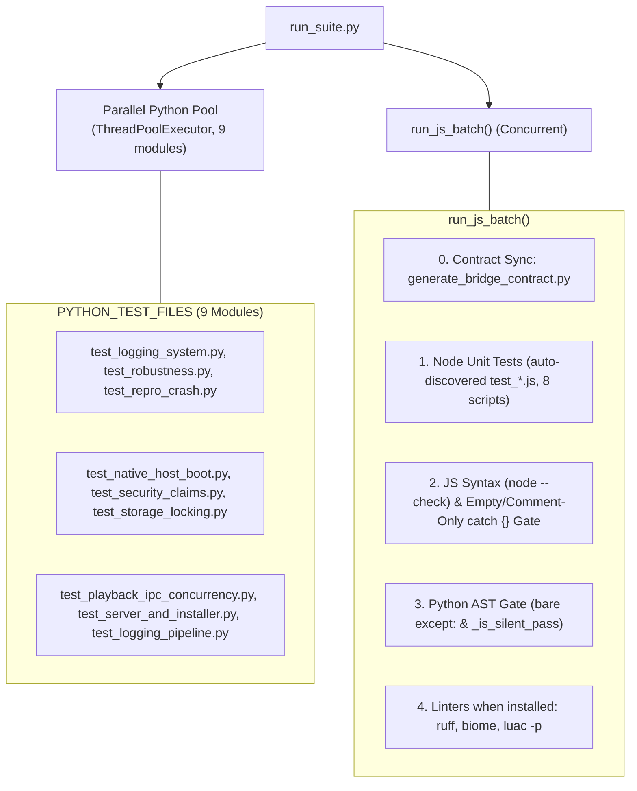

# Testing Harness, Suite Architecture & Authoring Standards

This skill defines the multi-batch test execution pipeline, `BaseTestCase` test harness, JSDOM browser simulation rules, and AST static checks.

---

## 1. Test Suite Architecture (`testing_tools/run_suite.py`)

`run_suite.py` runs `PYTHON_TEST_FILES` (all 9 Python test modules in parallel via `ThreadPoolExecutor`) concurrently with `run_js_batch()` (which runs contract sync, Node unit tests, static AST/regex gates, and available linters):



---

## 2. Python Test Harness (`testing_tools/base_test.py:BaseTestCase`)

All Python unit and integration tests **must** inherit from `BaseTestCase`:

```python
import sys
import os
sys.path.insert(0, os.path.dirname(os.path.dirname(os.path.abspath(__file__))))
from base_test import BaseTestCase

class MyFeatureTest(BaseTestCase):
    def test_my_feature(self):
        # self.test_dir is a clean temp directory
        temp_file = os.path.join(self.test_dir, "test.json")
        ...
```

### Provided Fixtures & Lifecycle

1. **`self.test_dir`:** An isolated temporary directory created per-test (`tempfile.mkdtemp()`). Automatically deleted in `tearDown()`.
2. **`self.mock_send(msg)`:** Intercepts outgoing bridge messages. Captured in `self.sent_messages`.
3. **Logger Initialization:** Automatically initializes `utils.logger` pointing to `self.test_dir`. `tearDown()` calls `logger.shutdown()` and clears root logging handlers.
4. **`self.wait_for_async(seconds=0.1)`:** Pauses execution to allow background daemon threads (such as `QueueListener`) to finish disk writes.
5. **Predefined Log Paths:** `self.main_log`, `self.ipc_log`, `self.browser_error_log`.

---

## 3. Static Analysis Gates (Python & JS)

`run_suite.py` enforces both Python AST gates and JavaScript regex gates across the project:

> [!CAUTION]
> **Strict AST & Catch-Block Rules:**
> 1. **No Bare `except:` Clauses:** Bare `except:` intercepts `KeyboardInterrupt` and `SystemExit`. Always catch `Exception` or specific error types.
> 2. **No Silent `except ...: pass` (`_is_silent_pass`):** Python `ExceptHandler` blocks containing only `pass` (without a `raise` or a function call such as logging) are rejected by the AST gate.
> 3. **No Empty or Comment-Only `catch {}` (`js_empty_catch_regex`):** JavaScript `catch` blocks that are empty or contain only comments are rejected.
>
> ```python
> # ❌ FORBIDDEN (bare except or silent pass):
> try:
>     do_something()
> except Exception:
>     pass
>
> # ✅ PERMITTED (logs or re-raises):
> try:
>     do_something()
> except Exception as e:
>     logging.debug(f"Failed: {e}")
> ```

---

## 4. JavaScript Node / JSDOM Simulation Patterns

Because Chrome extension APIs and DOM structures are not native to Node.js, frontend tests in `testing_tools/scripts/` simulate browser environments:

### Standard Environment Setup

- Use `jsdom` to construct a simulated DOM:
  ```javascript
  const { JSDOM } = require("jsdom");
  const dom = new JSDOM('<!DOCTYPE html><html><body><div id="playlist-container"></div></body></html>', {
      url: "https://www.youtube.com/watch?v=dQw4w9WgXcQ"
  });
  global.window = dom.window;
  global.document = dom.window.document;
  ```
- Mock extension APIs on `global.chrome`:
  - `chrome.runtime.sendMessage`, `chrome.runtime.onMessage`
  - `chrome.storage.local.get`, `chrome.storage.local.set`
  - `chrome.tabs.sendMessage`, `chrome.tabs.query`
- Verify against generated build files: Node tests load generated files (e.g., `utils/SystemLogger.js`) to verify transpilation parity.

---

## 5. Running the Test Suite

```bash
# Standard complete verification (build + full suite):
python3 verify_changes.py

# Verbose suite output:
python3 testing_tools/run_suite.py --verbose

# Watch mode (automatically re-runs suite on file modification):
python3 testing_tools/run_suite.py --watch
```


---

## 6. Audit Guardrails

### Every bug fix and hardening change ships with a regression test
Write the test first and confirm it fails without the fix. Prefer these patterns:

| Risk area | Required test style |
| :--- | :--- |
| Native host framing | Subprocess test sending oversized (>1 MiB reply), truncated, and malformed frames |
| `FileLock` / atomic writes | Multi-process contention test, stale and live holder cases, kill mid-write |
| IPC | Fake mpv server on a unix socket: full backlog, slow reply, dead peer, PID reuse |
| Local HTTP server | Missing token → 403, wrong `Host` → 403, concurrent slow client does not block |
| Security allowlists | An item-supplied dangerous value (`proxy=`, `exec`) is rejected |
| Service worker | Node + mocked `chrome.*`: simulate worker restart and assert state rehydrates |
| `nativeConnection` | Timeout, disconnect, throwing listener |
| Session races | Old waiter thread calling `clear()` after a new `start()` |

### Harness rules
1. `ruff` (`testing_tools/pyproject.toml`), `biome` (`testing_tools/biome.json`), and `luac -p` (`mpv_scripts/*.lua`) are executed by `run_suite.py` whenever installed (falling back to an info skip when a binary is absent); any lint/syntax error reported by an installed tool is a hard failure.
2. The static gate flags bare `except:`, silent `except ...: pass` (`_is_silent_pass`) in Python, and empty or comment-only `catch {}` (`js_empty_catch_regex`) in JS. A comment is not handling.
3. Tests must not mutate global logger state without restoring it. Use fixtures with teardown.
4. `verify_changes.py` and tests must not leave background processes behind.
5. Release packaging (`create_release.py`) excludes `*.log`, `native_host_crash.log` and local `data/`.
6. Keep `testing_tools/scripts/test_security_claims.py` up to date so `.gemini/skills/*/SKILL.md` claims about allowlists and limits match the code (e.g. a flag the skill calls "rejected" is actually rejected), preventing docs and code from drifting silently.
