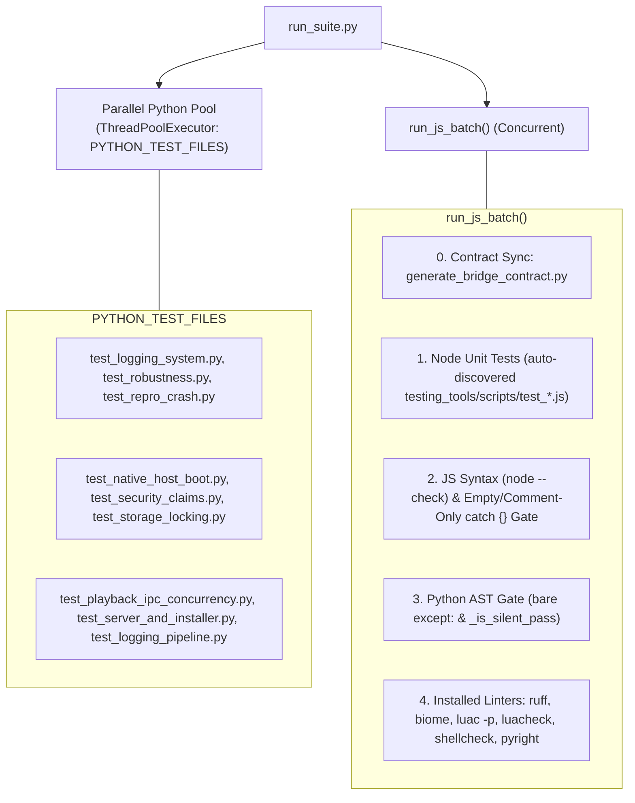

# Testing Harness, Suite Architecture & Authoring Standards

This skill defines the concurrent test execution pipeline in `testing_tools/run_suite.py`, static AST/regex gates, and regression test requirements.

> [!IMPORTANT]
> For `BaseTestCase` fixture boilerplate, JSDOM simulation setup, valid/invalid `try/except` code examples, and the risk-area regression test matrix, see [references/TEST_PATTERNS_AND_FIXTURES.md](references/TEST_PATTERNS_AND_FIXTURES.md).

---

## 1. Test Suite Architecture (`testing_tools/run_suite.py`)

`run_suite.py` executes `PYTHON_TEST_FILES` (all registered Python test modules in parallel via `ThreadPoolExecutor`) concurrently with `run_js_batch()`:



### Running the Suite
```bash
python3 verify_changes.py                    # Full build + test + static gate verification
python3 testing_tools/run_suite.py --verbose # Verbose suite output with linter details
python3 testing_tools/run_suite.py --watch   # Watch mode (re-runs on file changes)
```

---

## 2. Static Analysis & Exception-Handling Gates (`testing_tools/run_suite.py`)

`run_suite.py` enforces strict exception-handling rules across all Python and JavaScript files (excluding `yt-tools-legacy`, `yt-tools-standalone`, and `mpv-playlist-organizer-release`):
1. **No Bare `except:` Clauses:** Python `ExceptHandler` nodes with `node.type is None` fail the AST gate. Always catch `Exception` or specific exception classes.
2. **No Silent `except ...: pass` (`_is_silent_pass`):** Python `except` blocks containing only `pass` (without a `raise` or function call such as `logging.debug(...)`) fail the AST gate.
3. **No Empty or Comment-Only `catch {}` (`js_empty_catch_regex`):** JavaScript `catch` blocks that are empty or contain only comments fail the JS static check.

---

## 3. Audit Guardrails

1. **Every bugfix and security change ships with a regression test:** Write or update the test in `testing_tools/scripts/` and confirm it fails without the fix (see [references/TEST_PATTERNS_AND_FIXTURES.md](references/TEST_PATTERNS_AND_FIXTURES.md)).
2. **Inherit from `BaseTestCase` in Python tests:** Always use `self.test_dir` (`testing_tools/base_test.py:BaseTestCase`) so tests never touch the user's live `DATA_DIR` or leave stray log handlers attached.
3. **No leaked processes or temp directories:** Tests and `verify_changes.py` must clean up all spawned subprocesses, sockets, and temp directories during teardown.
4. **Linter gate enforcement:** Any error reported by an installed linter (`ruff`, `biome`, `luac -p`, `luacheck`, `shellcheck`, `pyright`) is a hard verification failure.
5. **Release hygiene (`testing_tools/create_release.py`):** Release builds exclude `*.log`, `*.tmp`, `*.bak`, `data`, `flags`, `.gemini*`, `testing_tools`, `yt-tools-legacy`, and `yt-tools-standalone*`.
6. **Keep `test_security_claims.py` synchronized with skills:** Whenever a security allowlist, flag rule, or limit in `.gemini/skills/security-and-diagnostics/` is updated, add a matching assertion in `testing_tools/scripts/test_security_claims.py`.
