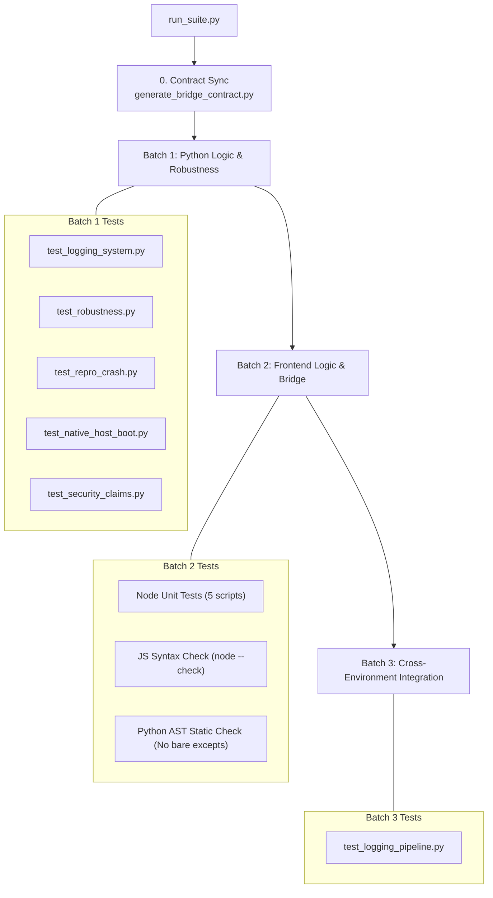

# Testing Harness, Suite Architecture & Authoring Standards

This skill defines the multi-batch test execution pipeline, `BaseTestCase` test harness, JSDOM browser simulation rules, and AST static checks.

---

## 1. Test Suite Architecture (`testing_tools/run_suite.py`)

The test suite executes in three segregated batches to isolate failures:



---

## 2. Python Test Harness (`testing_tools/base_test.py:BaseTestCase`)

All Python unit and integration tests **must** inherit from `BaseTestCase`:

```python
import sys
import os
sys.path.insert(0, os.path.dirname(os.path.dirname(os.path.abspath(__file__))))
from base_test import BaseTestCase

class MyFeatureTest(BaseTestCase):
    def test_my_feature(self):
        # self.test_dir is a clean temp directory
        temp_file = os.path.join(self.test_dir, "test.json")
        ...
```

### Provided Fixtures & Lifecycle

1. **`self.test_dir`:** An isolated temporary directory created per-test (`tempfile.mkdtemp()`). Automatically deleted in `tearDown()`.
2. **`self.mock_send(msg)`:** Intercepts outgoing bridge messages. Captured in `self.sent_messages`.
3. **Logger Initialization:** Automatically initializes `utils.logger` pointing to `self.test_dir`. `tearDown()` calls `logger.shutdown()` and clears root logging handlers.
4. **`self.wait_for_async(seconds=0.1)`:** Pauses execution to allow background daemon threads (such as `QueueListener`) to finish disk writes.
5. **Predefined Log Paths:** `self.main_log`, `self.ipc_log`, `self.browser_error_log`.

---

## 3. AST Static Analysis Rules (Python)

`run_suite.py` parses all `.py` files across the project with `ast.parse`:

> [!CAUTION]
> **Strict AST Rule: No Bare `except:` Clauses**
> The AST validator traverses all `ExceptHandler` nodes. Any bare `except:` without an exception type:
> ```python
> # ❌ FORBIDDEN (Will fail run_suite.py):
> try:
>     do_something()
> except:
>     pass
> 
> # ✅ PERMITTED:
> try:
>     do_something()
> except Exception:
>     pass
> ```
> Bare `except:` intercepts `KeyboardInterrupt` and `SystemExit`, breaking graceful termination and crash reporting. Always catch `Exception` or specific error types.

---

## 4. JavaScript Node / JSDOM Simulation Patterns

Because Chrome extension APIs and DOM structures are not native to Node.js, frontend tests in `testing_tools/scripts/` simulate browser environments:

### Standard Environment Setup

- Use `jsdom` to construct a simulated DOM:
  ```javascript
  const { JSDOM } = require("jsdom");
  const dom = new JSDOM('<!DOCTYPE html><html><body><div id="playlist-container"></div></body></html>', {
      url: "https://www.youtube.com/watch?v=dQw4w9WgXcQ"
  });
  global.window = dom.window;
  global.document = dom.window.document;
  ```
- Mock extension APIs on `global.chrome`:
  - `chrome.runtime.sendMessage`, `chrome.runtime.onMessage`
  - `chrome.storage.local.get`, `chrome.storage.local.set`
  - `chrome.tabs.sendMessage`, `chrome.tabs.query`
- Verify against generated build files: Node tests load generated files (e.g., `utils/SystemLogger.js`) to verify transpilation parity.

---

## 5. Running the Test Suite

```bash
# Standard complete verification (build + full suite):
python3 verify_changes.py

# Verbose suite output:
python3 testing_tools/run_suite.py --verbose

# Watch mode (automatically re-runs suite on file modification):
python3 testing_tools/run_suite.py --watch
```
