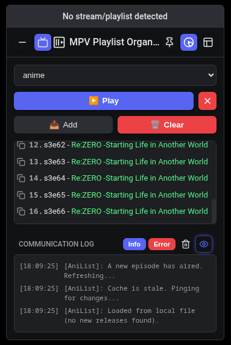
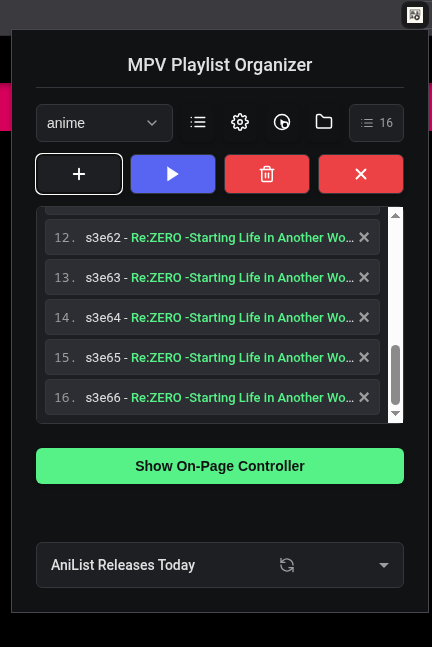
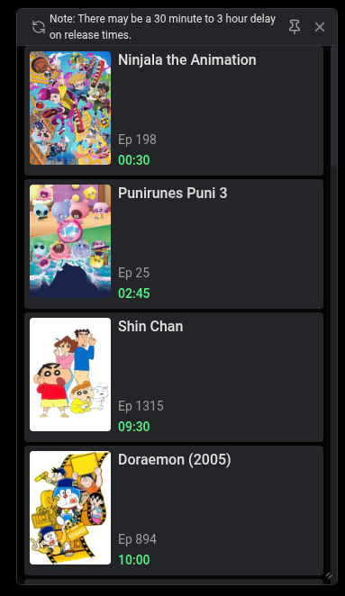
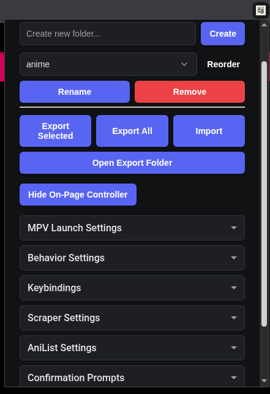
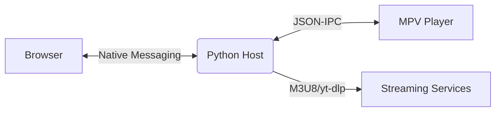

# 🎬 MPV Playlist Organizer

<div align="center">

[](https://opensource.org/licenses/MIT)
[](https://github.com/Mummykiller/mpv-playlist-organizer/releases)
[](https://mpv.io/)

**A powerful browser extension for capturing video streams and managing playlists with MPV**

[Quick Start](#-quick-start) • [Features](#-core-features) • [Usage Guide](#-usage-guide) • [Installation](#-installation) • [CLI](#-command-line-interface)

</div>

---

## 📋 Overview

MPV Playlist Organizer is a browser extension that captures video stream URLs (M3U8, MPD) and YouTube links, organizes them into persistent playlists, and plays them directly in the [MPV media player](https://mpv.io/). 

Experience seamless video management with a draggable on-page UI, **real-time session synchronization**, and **precise resume tracking**—all without leaving your browser.

> **Development Note:** This extension was developed through human-AI collaboration, combining AI assistance with human direction and oversight.

### 📸 Screenshots

<div align="center">

| On-Page Controller | Popup Interface |
|:------------------:|:---------------:|
|  |  |

| AniList Integration | Settings Panel |
|:-------------------:|:--------------:|
|  |  |

</div>

---

## 🚀 Quick Start

Get up and running in 5 simple steps:

1. **📥 Download** — Clone or download the repository to a **permanent location**.
2. **🔧 Install** — Run `installer.py` (GUI) or `installer_cli.py` (Terminal) and follow the prompts.
3. **🧩 Load Extension** — Open `chrome://extensions`, enable **Developer mode**, and click **Load unpacked**. Select the repository folder.
4. **🔗 Connect** — Click **"Detect"** in the installer to automatically discover your Extension ID (or paste it manually) and click **"Install"**.
5. **♻️ Restart** — **Completely restart your browser** to register the native messaging host.

📚 [Detailed installation instructions](#-installation)

---

## ✨ Core Features

### 🎯 Advanced Playback & Queue
- **Precise Resume Tracking** — Tracks your position down to the second. Uses the `--start` flag to bypass inconsistent network stream resumes.
- **Smart Order Restoration** — Launch any episode in a playlist; the extension automatically "reconstructs" the surrounding context in the player queue.
- **Dynamic Queue & Append** — Adding items to a running playlist automatically updates the play button to **`➕` Queue**, appending new streams live without interrupting playback.
- **Sequential Playback Queue** — Stack multiple videos to play consecutively in the same MPV instance.
- **Session Restoration** — Reconnect to your active MPV instance even after closing your browser.
- **Adaptive Headers & Anti-Hotlinking** — Injects dynamic `Referer` and `User-Agent` headers via Lua scripts (`adaptive_headers.lua`) to prevent 403 errors on protected streaming sources.
- **Native M3U Enrichment** — Generates metadata-rich M3U playlists to guarantee title preservation and playback stability.

### 🎨 Intelligent User Interface
- **Draggable Controller** — A floating on-page UI that snaps to corners and can be minimized to a discreet button.
- **AniList Dashboard** — A dedicated, draggable panel showing today's airing anime with integrated search and playback.
- **Quick Action Bar (⏮️, 🔀, ⚡)** — Instant access to beginning-play / pick-start mode, live drag-and-drop reordering & smart sort, and detached MPV window launches.
- **YouTube Tools Tab (Opt-In)** — An isolated, built-in YouTube companion (disabled by default) featuring feed & Shorts filtering, anti-distraction controls, custom player enhancements, hover-preview protection, and a Watch Later library.
- **Popup Playlist Manager** — Quick access to your folders, settings, and full queue from the browser toolbar.
- **SPA Compatibility** — Native support for modern Single-Page Applications (YouTube, etc.) via MutationObservers.

### ⚡ Live Interaction
- **Real-Time Sync** — Adding, removing, or reordering items in the browser UI can instantly update the running MPV instance via JSON-IPC.
- **Context Menu Integration** — Right-click any link, video, or thumbnail to add it instantly to your preferred folder.
- **Double-Click Title Copy** — Quickly copy video titles directly from the playlist UI for easy sharing or searching.

### 🔧 Power User Features
- **One-Click ID Detection** — The installer can automatically detect your Extension ID by scanning your browser profiles.
- **Headless Terminal Setup** — Includes `installer_cli.py` for terminal-only, Wayland, or SSH installations without Tkinter.
- **Browser Cookie Sync** — Uses your browser's cookies (Chrome/Brave/Edge/Vivaldi) for YouTube playback to support watch history, subscriptions, and private videos.
- **yt-dlp Auto-Update** — Detects when `yt-dlp` is outdated (fixing 410 Gone errors) and offers a one-click automatic update.
- **The Janitor** — Built-in automated cleanup that wipes temporary M3U files and stale IPC sockets on startup.
- **Customizable Keybindings (⌨️)** — Set global browser shortcuts (<kbd>Shift+A</kbd>, <kbd>Shift+P</kbd>, <kbd>Shift+S</kbd>, <kbd>Shift+Tab</kbd>, <kbd>Alt+P</kbd>) for Adding, Playing, Switching playlists, or Toggling the UI.

---

## 📖 Usage Guide

### ➕ Adding Videos & Streams
* **On-Page Controller:** On any video page (YouTube, supported streaming sites), click the floating **`+` (Add)** button to save the current media into your selected folder.
* **Context Menu:** Right-click any link, video player, or video thumbnail and select **"Add to MPV Playlist"**.
* **Auto-Add Mode:** Right-click the Add button to toggle **Auto-Add**; video links will be detected and saved automatically as you browse.

### ▶️ Playback & Queuing
* **Play / Pause:** Click **Play** to start playback. When MPV is already running the selected playlist, clicking it toggles pause.
* **Queueing New Items:** If you add new items while MPV is playing, the play button automatically turns into **`➕` Queue**. Clicking it appends the new items to the live player without restarting.
* **Playing Specific Items:** Click any item in the playlist view to immediately switch playback to that episode or video.

### ⌨️ Default Keyboard Shortcuts

| Shortcut | Action | Description |
|:---:|---|---|
| <kbd>Shift</kbd> + <kbd>A</kbd> | 📥 **Add Active Stream** | Instantly captures and adds the active video stream on the page to the selected playlist |
| <kbd>Shift</kbd> + <kbd>P</kbd> | ▶️ **Play Selected Playlist** | Launches MPV or toggles playback pause for the current folder |
| <kbd>Shift</kbd> + <kbd>S</kbd> | 🎛️ **Toggle On-Page Controller** | Shows or hides the floating on-page overlay controller |
| <kbd>Shift</kbd> + <kbd>Tab</kbd> | 📁 **Switch Playlist** | Cycles through your available playlist folders |
| <kbd>Alt</kbd> + <kbd>P</kbd> | 📌 **Open Browser Popup** | Opens the extension popup window from any tab |

> 💡 All keyboard shortcuts can be customized or disabled in **Settings ➔ ⌨️ Keyboard Shortcuts**.

### 🎛️ Quick Actions Bar
The quick actions bar on the controller and popup provides fast-access playback modes:
* **⏮️ `Start From Beginning / Pick Start`:**
  * *Left-Click:* Starts playback from the very first item in the playlist.
  * *Right-Click:* Activates **Pick Start Mode**—click any item in the list to begin playback from that specific item.
* **🔀 `Live Reorder & Smart Sort`:**
  * *Left-Click:* Enables interactive drag-and-drop playlist reordering that synchronizes live with the running MPV player instance.
  * *Right-Click:* Triggers **Smart Reorder** (natural episode numbering sort).
* **⚡ `Detached / Independent Launch`:** Toggles selection mode—click any chosen video in the playlist to launch it in a separate, detached MPV player instance without affecting your main session.

### 📺 YouTube Tools (Opt-In)
Switch to the **YouTube Tools** tab at the top of the browser popup to turn on the built-in YouTube companion (disabled by default so it adds zero overhead unless enabled):
* **Library:** Bookmark YouTube videos (via the player `+` button, thumbnail quick-save, or right-click **"Save to Shinku YT Library"**), resume from saved timestamps, and track finished videos in the Done folder.
* **Settings:** Customize **Feed & Card Filtering** (hide Shorts, Lives, Mixes, watched cards, or keyword matches), **Page Layout & Anti-Distraction**, **Video Player & Playback** (preferred quality, speed, wheel volume, custom arrow seeking), **Thumbnails, Titles & Links** (hover-preview protection, tracking-parameter cleanup), and **Watch Later / Library** preferences.

---

## 💻 Command-Line Interface

The extension includes a powerful CLI wrapper for managing your media without opening a browser.

### Usage Examples

| Command | Description |
|---------|-------------|
| `mpv-cli list` | Lists all available folders and their item counts |
| `mpv-cli play "Watchlist"` | Launches MPV with the specified playlist |

### Setup
1. Open `installer.py` (or `installer_cli.py`) and click **"Install CLI Wrapper"**.
2. Click **"Add Folder to User PATH"** — on Windows this updates your user `PATH` automatically, and on Linux/macOS it displays a copyable shell command for your `~/.bashrc`, `~/.zshrc`, or `~/.bash_profile`.

---

## 📦 Installation

### Prerequisites

| Requirement | Description |
|-------------|-------------|
| **Browser** | Chromium-based (Chrome, Edge, Brave, Vivaldi) — *Firefox not supported* |
| **MPV Player** | [Download here](https://mpv.io/installation/) — Must be in PATH or selected in installer |
| **yt-dlp** | [Install guide](https://github.com/yt-dlp/yt-dlp) — Required for YouTube & streaming extraction |
| **Python** | Python 3.8+ (GUI requires `tkinter`; terminal CLI installer `installer_cli.py` works out-of-the-box without GUI dependencies) |

---

## ⚙️ How It Works

The extension uses a **secure three-tier architecture**:

1. **Browser Extension (UI)**: Captures URLs and manages the user state.
2. **Native Messaging Host (Python)**: A bridge that handles file I/O, `yt-dlp` resolution, and MPV process management.
   - **Windows Process Name**: `mpv playlist organizer` (visible in Task Manager Processes tab).
   - **Linux Process Name**: `mpv-pl-organize` (visible in `top`, `htop`, or System Monitor).
3. **MPV Media Player**: The playback engine, controlled via a **JSON-IPC socket**.



---

## 🔧 Troubleshooting

<details>
<summary><strong>🔍 Run Diagnostics</strong></summary>

If you encounter issues, open `installer.py` (or `installer_cli.py`) and click **Run Diagnostics**. This streams live progress while verifying:
- ✅ MPV & yt-dlp installation/version
- ✅ FFmpeg & Node.js availability
- ✅ Browser cookie access permissions

</details>

<details>
<summary><strong>🔌 Native Host Disconnected</strong></summary>

- **Completely restart your browser** after installation.
- Verify you haven't moved the project folder after running the installer.
- Ensure the extension ID in the installer matches the one in `chrome://extensions`.

</details>

<details>
<summary><strong>🐧 Linux Specifics & Headless Installation</strong></summary>

- **Terminal Installer:** If you prefer running without a GUI, or if Tkinter is not installed, use the terminal installer:
  ```bash
  python3 installer_cli.py
  ```
- **GUI Installer:** To launch the graphical `installer.py`, ensure Python Tkinter is installed on your distribution:
  ```bash
  sudo apt install python3-tk      # Ubuntu / Debian / Mint
  sudo pacman -S tk                # Arch Linux / Manjaro
  sudo dnf install python3-tkinter # Fedora / RHEL
  ```

</details>

---

## 🤝 Contributing & License

Contributions are welcome! This project is licensed under the **MIT License**.

<div align="center">

**Made with ❤️ for the MPV community**

[⭐ Star on GitHub](https://github.com/Mummykiller/mpv-playlist-organizer) • [🐛 Report Bug](https://github.com/Mummykiller/mpv-playlist-organizer/issues) • [💡 Request Feature](https://github.com/Mummykiller/mpv-playlist-organizer/issues)

</div>
