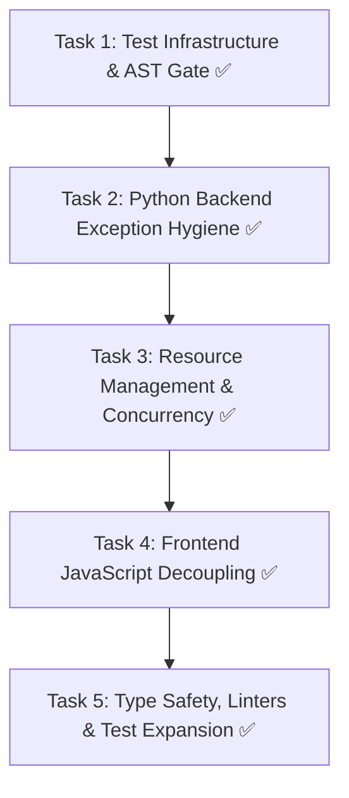

# Codebase Improvement & Technical Debt Reduction Plan

> [!NOTE]
> This plan focuses **strictly on improvements, hardening, performance, and technical debt reduction**. No new end-user features are included.
> **Tracking Protocol:** All tasks have been completed, verified, and audited. Completed items are struck out below (`- [x] ~~Task~~`).

---

## Architecture & Improvement Roadmap

---

## Task 1: Test Infrastructure & Hardened AST Gate

### Context & Goal
Track critical test and transpiler infrastructure in git without committing third-party dependencies, and enforce an uncompromising static gate preventing any agent from introducing silent error suppressions.

- [x] ~~**1.1 Correct `.gitignore` Scope for Test Infrastructure**~~
  - Updated `.gitignore` to track `testing_tools/` and `verify_changes.py` while strictly ignoring `testing_tools/node_modules/`.
  - Cleaned up stale/obsolete patterns in `.gitignore`.
- [x] ~~**1.2 Hardened AST Gate Against Silent Error Suppression**~~
  - Extended the static analysis gate in `testing_tools/run_suite.py`:
    - **Python AST:** Rejects and fails the build on any bare `except:` or `except <Any>: pass` where the handler body only contains `pass` without logging or explicit re-raise.
    - **JavaScript Gate:** Checks for empty `catch (e) {}` blocks across frontend and test scripts to block silent promise/error swallowing.
- [x] ~~**1.3 Version-Control Test Infrastructure**~~
  - Staged and committed `testing_tools/` and `verify_changes.py` to establish a durable repository baseline.

---

## Task 2: Python Backend Exception Hygiene & State Encapsulation

### Context & Goal
Eliminate the 70 uncovered silent `except Exception: pass` blocks in the Python backend that mask disk corruption, file lock contention, and process crashes, and encapsulate global path state.

- [x] ~~**2.1 Replace Silent Passes in `file_io.py` & `mpv_session.py`**~~
  - Replaced broad `except Exception: pass` with targeted exception types: `(FileNotFoundError, PermissionError, OSError, json.JSONDecodeError)`.
  - Added contextual diagnostics: `logging.debug(...)` instead of empty suppression.
- [x] ~~**2.2 Narrow Broad Suppressions in `native_host.py`, `services.py`, & Handlers**~~
  - Replaced generic `except Exception: pass` in process title setting with `except (OSError, AttributeError):`.
  - Replaced generic `except Exception: pass` in GPU detection with `except (subprocess.SubprocessError, OSError, FileNotFoundError):`.
  - Replaced `delayed_cleanup` generic pass in `utils/handlers/playback_handler.py` with specific `OSError` logging.
  - Ensured failsafe crash logger outputs to `sys.stderr` if disk logging fails.
- [x] ~~**2.3 Encapsulate Global Path State in `file_io.py`**~~
  - Refactored mutable module globals (`DATA_DIR`, `FOLDERS_FILE`, `PLAYLISTS_DIR`, etc.) into an immutable `PathConfig` container with factory `create()` and accessor `get_paths()` while maintaining full backward compatibility for existing consumers.

---

## Task 3: Resource Management & Concurrency Hardening

### Context & Goal
Sanitize subprocess environments, bound background thread execution, and prevent orphaned MPV processes or socket descriptors from accumulating.

- [x] ~~**3.1 Centralize Subprocess Environment Scrubbing**~~
  - Consolidated duplicate implementations of `get_scrubbed_env` from `utils/session_services.py`, `utils/url_analyzer.py`, and `utils/dependency_manager.py` into `utils/security.py`.
- [x] ~~**3.2 Bounded ThreadPool Lifecycle for Enrichment**~~
  - Replaced ad-hoc `ThreadPoolExecutor(max_workers=10)` calls inside `MpvSessionManager.start` with a shared bounded executor managed by `EnrichmentService` with clean teardown.
- [x] ~~**3.3 Guaranteed Shadow-Copy Profile Teardown**~~
  - Wrapped temporary shadow directory creation in `VolatileCookieManager.extract_with_shadow_copy` in `tempfile.TemporaryDirectory` context management with emergency `atexit` registration to guarantee immediate deletion on exceptions, SIGINT, or SIGTERM.
- [x] ~~**3.4 IPC Pipe Descriptor & Stale Socket Audit**~~
  - Implemented `cleanup_stale_sockets()` and verified that `IPCSocketManager.close()` and `MpvSessionManager.clear()` reliably close all socket descriptors and unlink dead sockets in `/tmp/mpv_sockets` and `/dev/shm`.

---

## Task 4: Frontend JavaScript Decoupling & Error Boundaries

### Context & Goal
Reduce monolithic sprawl in `popup.js` (2,515 lines) and `utils/MpvController.js` (2,238 lines), and establish resilient error boundaries so DOM or URL format changes display clear UI banners rather than failing silently.

- [x] ~~**4.1 Deduplicate Modal Confirmations & Status Banners**~~
  - Consolidated confirmation dialogs (`confirmStacked`) and status banner notifications across `popup.js` and `MpvController.js` into shared helpers in `utils/domUtils.module.js` and `utils/commUtils.module.js` compliant with Shadow DOM and Golden Build rules.
- [x] ~~**4.2 Standardize Async Error Boundaries in Frontend Handlers**~~
  - Wrapped all asynchronous event listeners and background message dispatches in `popup.js`, `background.js`, and `content.js` with structured error reporting to `SystemLogger.error` and `browser_errors.log`.
  - Added non-intrusive floating status notification banner in the UI rather than freezing the view on external errors.
- [x] ~~**4.3 Clean Up Legacy Inline CSS Constructions**~~
  - Replaced repetitive programmatic inline style assignments with standard CSS classes styled within Shadow DOM style blocks.

---

## Task 5: Type Safety, Non-Interactive Linters & Test Expansion

### Context & Goal
Automate automated checks with non-interactive flags so agents cannot get stuck waiting for user input, and add regression tests for recovery edge cases.

- [x] ~~**5.1 Non-Interactive Static Linter Integration**~~
  - Configured `testing_tools/run_suite.py` and `verify_changes.py` to automatically execute `ruff check --no-fix` and `@biomejs/biome check` with non-interactive flags when available, while preserving the zero-dependency built-in AST + Node syntax checks.
- [x] ~~**5.2 Core Python Type Annotations**~~
  - Added type annotations across public interfaces in `file_io.py`, `utils/security.py`, `utils/url_analyzer.py`, and `services.py`.
- [x] ~~**5.3 Edge-Case Test Scenarios**~~
  - Added `test_filelock_stale_pid_recovery` verifying `FileLock` stale lock recovery when a lock file exists but holding PID is dead.
  - Added `test_native_connection_backoff_and_reconnect` verifying `nativeConnection.module.js` reconnection backoff and timeout handling.
  - Verified all 75 tests remain 100% green and execution time remains under 19 seconds.

---

## Verification & Acceptance Criteria
1. `python3 verify_changes.py` passes cleanly in streamlined mode (75/75 tests, 54 JS checks, 58 Python static checks).
2. The AST static check fails immediately if a silent `except ...: pass` or empty `catch {}` block is introduced.
3. Linters run strictly non-interactively without prompting or stalling.
4. `TODO.md` is updated and all items struck out as completed.
